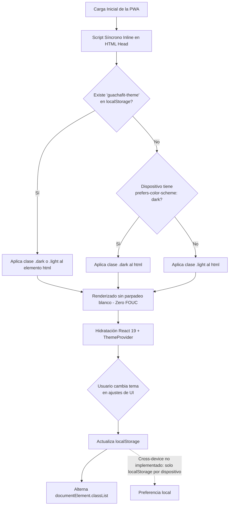

# 🏛️ Evaluación de Alternativas Tecnológicas y Stack Recomendado - MVP GUACHAFIT

> **Objetivo del Documento:** Realizar un análisis comparativo riguroso (*Trade-off Analysis*) y establecer la fundamentación técnica de las elecciones del stack tecnológico para el MVP de **GUACHAFIT**, garantizando el cumplimiento de los requerimientos funcionales (`RF-001` a `RF-016`), no funcionales (`RNF-001` a `RNF-004`) y decisiones arquitecturales (`ADR-001` a `ADR-010`).

---

## 🧭 1. Resumen Ejecutivo del Stack Tecnológico Recomendado

```mermaid
flowchart TB
    subgraph ClientLayer ["Capa de Clientes (Offline-First & Responsive)"]
        CoachWeb["Entrenador (Desktop / Tablet / Mobile Web)\nReact 19 + Vite + Tailwind CSS\nDashboard de Comando (RF-013) + Recharts"]
        AthletePWA["Alumno (PWA Instalable / Mobile-First)\nReact 19 + Vite + Workbox + Tailwind\nDexie.js (IndexedDB) + TanStack Query"]
        CameraCanvas["Módulo Cámara & Compresión\nCanvas / OffscreenCanvas API\nWebP 85% (<600 KB, <500ms)"]
        AthletePWA --> CameraCanvas
    end

    subgraph EdgeLayer ["Capa Perimetral & Storage (Cloudflare)"]
        CFDNS["Cloudflare DNS / DDoS / SSL"]
        CFR2["Cloudflare R2 Storage (S3-Compatible)\nBuckets Privados (Fotos & Comprobantes)\nZero Egress Fees + AES-256"]
    end

    subgraph APILayer ["Capa de Aplicación (NestJS Monolito Modular)"]
        Gateway["Reverse Proxy / Nginx / Traefik\nRate Limiting + SSL Termination"]
        
        subgraph CoreBackend ["NestJS Backend (Node.js 22 LTS / TypeScript)"]
            AuthModule["IAM & RBAC Module (RF-010, RF-011)\nJWT + Invitation Tokens (SHA-256)"]
            TrainModule["Training Module\n(RF-001, RF-002)"]
            AnthroModule["Anthropometry Module\n(RF-003, RF-004, RNF-001)"]
            ClientModule["Client Lifecycle & CRM Module\n(RF-011, RF-012, RF-013, RNF-003)"]
            FinanceModule["Finance & Ledger Module\n(RF-005, RF-006, RF-007, RF-008, RNF-002)"]
            EventDispatcher["Event-Driven Notification Dispatcher\n(RF-014, RF-015, RF-016, ADR-010)"]
            JobScheduler["BullMQ Scheduler & Workers\nRecordatorios T-5..T+2, Push FCM, Email"]
        end
    end

    subgraph DataLayer ["Capa de Persistencia & Mensajería"]
        Postgres[("PostgreSQL 16+ (Multi-Tenant RLS)\nRow-Level Security por entrenador_id (ADR-009)\nTipos: NUMERIC(14,2), TIMESTAMPTZ\nDrizzle ORM + Connection Pooling (PgBouncer)")]
        RedisStore[("Redis 7+ (In-Memory)\nBullMQ Queue Engine (notifications-push, notifications-email)\nIdempotency Keys & Delayed Jobs")]
    end

    AthletePWA <-->|HTTPS / REST API / Idempotency-Key| Gateway
    CoachWeb <-->|HTTPS / REST API| Gateway
    AthletePWA -.->|Direct Upload via Presigned PUT URL| CFR2
    Gateway --> CoreBackend
    CoreBackend -->|SQL / RLS Session (SET LOCAL)| Postgres
    CoreBackend -->|Colas & Workers| RedisStore
    CoreBackend -->|Presigned URL Generator (AWS SDK v3)| CFR2
```

---

## 📱 2. Capa de Frontend y Aplicación de Usuario: Alumnos y Entrenador

### 2.1. Contexto Operativo y Requerimientos Críticos
1. **Ambiente de Gimnasio (Offline-First, `RF-001`):**
   - Los sótanos y zonas con blindaje electromagnético de los gimnasios causan caídas frecuentes de cobertura móvil.
   - El alumno debe registrar sus series sin experimentar bloqueos de red ($< 16$ ms de latencia percibida en UI).
2. **Cámara y Compresión en Cliente (`RNF-001`):**
   - Fotos de comidas (hasta 4/día, `RF-002`) y de control corporal (`RF-003`) capturadas desde sensores modernos (12–108 MP) deben comprimirse en el dispositivo antes de ser enviadas, reduciéndose a WebP 85% ($< 600$ KB en $< 500$ ms) mediante la API de `OffscreenCanvas`.
3. **Dualidad de Roles y Responsividad (`RF-013`):**
   - **Alumno:** Interacción táctil en smartphones mediante PWA instalable con diseño ergonómico de 1-Tap.
   - **Coach:** Uso móvil para cobros en sala y asistencia presencial (`RF-007`, `RF-011`), complementado con vistas de escritorio/tablet para el **Dashboard de Comando** (`RF-013`) con 4 KPIs macro y bandejas operativas.

### 2.2. Evaluación de Alternativas

| Criterio | Opción A: PWA Instalable (React 19 + Vite + Dexie/Workbox) | Opción B: React Native con Expo (Expo Router + SQLite) | Opción C: Flutter (Dart + Isar/Hive) |
| :--- | :--- | :--- | :--- |
| **Soporte Offline-first** | ⭐⭐⭐⭐☆ Excelente vía Service Workers (Workbox) + IndexedDB (Dexie.js). TanStack Query Mutation Queue para reintentos. | ⭐⭐⭐⭐⭐ Nativo superior con SQLite local (`expo-sqlite` / WatermelonDB) y persistencia nativa en disco. | ⭐⭐⭐⭐⭐ Excelente mediante base de datos Isar embebida y SQLite. |
| **Acceso a Cámara y Compresión** | ⭐⭐⭐⭐☆ API HTML5 `<input type="file" capture="environment">` o `MediaDevices` + Web Worker con `OffscreenCanvas`. Rápido y sin plugins. | ⭐⭐⭐⭐⭐ Acceso nativo directo vía `expo-camera` y `expo-image-manipulator` con subida en background. | ⭐⭐⭐⭐⭐ `camera` package + `flutter_image_compress` en Isolate nativo. |
| **Velocidad de Salida al Mercado (MVP)** | ⭐⭐⭐⭐⭐ **Máxima:** Un único codebase responsivo para Alumnos y Entrenador. Despliegue continuo instantáneo sin revisión de tiendas. | ⭐⭐⭐☆☆ Requiere compilar binarios iOS/Android (EAS Build), tramitar cuentas de desarrollador Apple (\$99/año) y Google (\$25), y esperar revisiones de App Store. | ⭐⭐☆☆☆ Requiere aprender Dart, mantener widgets independientes para web y compilar binarios para dos tiendas móviles. |
| **Experiencia de Usuario (UX) en Gimnasio** | ⭐⭐⭐⭐☆ Instalable en pantalla de inicio (Add to Home Screen / WebAPK). UI idéntica a app nativa con CSS táctil (`touch-action: manipulation`, safe-area-inset). | ⭐⭐⭐⭐⭐ Fluidez nativa a 60/120 fps, transiciones nativas y retroalimentación háptica directa. | ⭐⭐⭐⭐⭐ Renderizado de alto rendimiento vía Skia / Impeller. |
| **Costo Operacional Inicial** | ⭐⭐⭐⭐⭐ **$0 en tiendas de apps.** Actualizaciones directas en el servidor web. | ⭐⭐☆☆☆ Costos de cuentas de Apple/Google, mantenimiento de pipelines de CI/CD para binarios móviles. | ⭐⭐☆☆☆ Costos de cuentas en tiendas y mayor esfuerzo de mantenimiento de dos stacks (Dart + Web). |

### 2.3. Decisión Técnica de Frontend
Se adopta **Opción A: PWA Instalable de Alto Rendimiento**:
- **Stack Base:** **React 19 + TypeScript + Vite 6** con **React Router 7** para el enrutado de la SPA.
- **Sistema de Diseño y Estilos (estado actual 2026-09-21):** **Tailwind CSS v4** con **tokens semánticos HSL** para tema claro/oscuro (contraste AA y piso tipográfico de 11px). **Primitivas Radix puntuales** montadas directamente en el código —`DropdownMenu` en paginación y filtros (`ADR-013`)— junto con **hooks propios** de accesibilidad para diálogos (`useDialogoAccesible`) y tabs (`useTabsAccesibles`) e iconografía **Lucide**. Se evaluó y **descartó** adoptar el registry de `shadcn/ui` como sistema (no existe `src/components/ui/`), al igual que los drawers `vaul` y los toasts `Sonner`; ver [[ADR-004-stack-frontend-pwa-offline-first]] §"Estado implementado".
- **Persistencia Offline y Cache:** **Dexie.js v4 (IndexedDB)** para el ledger local —cola *outbox* de mutaciones (`outboxMutations` con estados `pending/syncing/synced/failed/rejected`), rutina del día y check-ins de nutrición—, combinado con **TanStack Query v5** para el estado de servidor de las listas paginadas (`ADR-013`), sin `persistClient`.
- **Service Worker:** **Workbox vía `vite-plugin-pwa`** con `registerType: 'prompt'`: precache de assets del build, `NetworkFirst` con TTL de 24 h para los `GET` de API, actualización guiada por banner ("Nueva versión disponible") y frescura offline visible; decisión completa en [[ADR-014-actualizaciones-guiadas-sw-frescura-offline]].
- **PWA Instalable:** `manifest` con iconos 192/512/maskable/apple y shortcuts ("Entrenar hoy", "Mi menú"), sin orientación forzada; safe-areas con `env()` + `dvh`, zoom habilitado (sin `user-scalable=no`) y `navigator.storage.persist()` best-effort para proteger IndexedDB y la caché (ver [[ADR-004-stack-frontend-pwa-offline-first]] §"Estado implementado").
- **Compresión de Imágenes:** Módulo cliente en TypeScript utilizando `OffscreenCanvas` para generar blobs `image/webp` a resolución máx. de 1920px (lado mayor) y calidad 82-85% antes de invocar el upload directo a Cloudflare R2 (`ADR-004`).
- **Ruta de Crecimiento Futuro:** Empaquetado en **Capacitor 6** para publicación en tiendas si el negocio requiere distribución en Google Play o Apple App Store, preservando el 85% del código.

### 2.4. Arquitectura de UI/UX: Tailwind CSS v4, Primitivas Radix y Estrategia de Dark Mode Persistente

#### 2.4.1. Justificación de Tailwind CSS v4 + primitivas Radix frente a librerías monolíticas
1. **Rendimiento de Compilación y Bundle:** Tailwind CSS v4 introduce un motor CSS-first ultra-rápido en Rust (Lightning CSS), configurando variables y temas directamente con directivas `@theme` nativas. Esto reduce los tiempos de recarga HMR en desarrollo a $< 10$ ms y genera hojas de estilo de producción $< 15$ KB.
2. **Primitivas Radix puntuales + componentes propios (estado actual 2026-09-21):** Se evaluó y **descartó** adoptar `shadcn/ui` como sistema de componentes (registry *copy-pasteable* que viviría en `src/components/ui/`): esa carpeta no existe y cada componente vive junto a su pantalla. Las primitivas headless de **Radix UI** se montan directamente donde aportan accesibilidad probada (`DropdownMenu`), y el resto de los patrones se resolvió con **hooks propios y testeables**:
   - **Para el Entrenador (Dashboard de Comando `RF-013`):** tablas propias + `TanStack Query` para paginación/búsqueda server-side y `Radix DropdownMenu` en los controles de página y filtros (`ADR-013`); diálogos modales accesibles vía `useDialogoAccesible` (Escape, trampa de foco y restore) y tabs con `useTabsAccesibles` (patrón ARIA APG). `@tanstack/react-table`, `cmdk` (Command Palette) y los paneles `Sheet` no se adoptaron.
   - **Para el Alumno (Checklist y Gimnasio `RF-001`, `RF-002`):** botones grandes de 1-Tap con retroalimentación inmediata y tarjetas de series con bordes de contraste; los drawers táctiles `vaul` y los toasts `Sonner` se evaluaron y **descartaron** (los avisos usan componentes propios).

#### 2.4.2. Estrategia de Dark Mode Persistente Multicapa
El modo oscuro no es solo una preferencia estética; en el contexto de **GUACHAFIT** es un requerimiento ergonómico crítico:
- En salas de pesas y gimnasios con iluminación tenue o artificial intensa, una pantalla blanca brillante encandila al atleta y genera fatiga visual en sus descansos.
- En dispositivos móviles con pantallas OLED/AMOLED, el fondo oscuro profundo ahorra hasta un 30% de consumo de batería durante sesiones de entrenamiento de 60 a 90 minutos.



1. **Prevención de Parpadeo (Zero FOUC - Flash of Unstyled Content):**
   Para evitar el molesto destello blanco al abrir la aplicación antes de que React cargue en el navegador, se inyecta un micro-script síncrono bloqueante en la cabecera `<head>` de `index.html`:
   ```html
   <script>
     (function() {
       try {
         const stored = localStorage.getItem('guachafit-theme');
         const systemDark = window.matchMedia('(prefers-color-scheme: dark)').matches;
         if (stored === 'dark' || (!stored && systemDark)) {
           document.documentElement.classList.add('dark');
         } else {
           document.documentElement.classList.remove('dark');
         }
       } catch (_) {}
     })();
   </script>
   ```
2. **Selector Tri-Estado en UI (`ThemeProvider`):**
   La aplicación expone tres opciones en la configuración del perfil:
   - `system` (Sigue automáticamente el tema del sistema operativo / sensor de luz).
   - `dark` (Fuerza modo oscuro permanente).
   - `light` (Fuerza modo claro permanente).
3. **Tokens Semánticos HSL de Alto Contraste (estado actual 2026-09-21):**
   - Se reemplazó la paleta fija (`zinc-950` y acentos *hardcodeados*) por **tokens semánticos en HSL** con variante clara (`:root`, "Athletic Slate" sobre lienzo suave, nunca blanco puro) y oscura (`.dark`, capas de elevación frías, nunca negro puro): `--background`, `--card`, `--popover`, `--primary`, `--success`, `--warning`, `--danger`, `--info`, `--border`, etc. (501 usos migrados).
   - **Contraste AA medido en ambos temas** y **piso tipográfico de 11px**; prohibido usar paletas fijas sin variante de tema (ver [[ADR-004-stack-frontend-pwa-offline-first]] §"Estado implementado").
   - Los estados funcionales se consumen por token, no por valor hex directo: relleno sólido con la variante `strong` y `-foreground` para el contenido sobre él —**Éxito / Serie Completada** (`success`), **Advertencia / Pendiente de Pago** (`warning`), **Mora / Crítico** (`danger`) e **Informativo** (`info`); el violeta queda como acento decorativo (`decor`), no como color de selección.
4. **Persistencia Local (estado actual 2026-09-21):**
   - La preferencia se guarda en `localStorage` (clave `guachafit-theme`) con selector tri-estado (`system`, `dark`, `light`) para disponibilidad instantánea offline.
   - La columna `usuarios.tema_ui` y el endpoint `PATCH /api/v1/usuarios/me/preferencias` ([[03_Contratos_API_Especificacion]] §3.4) existen en el backend, pero la **sincronización cross-device no está implementada**: la PWA no invoca ese endpoint y el tema permanece local al dispositivo (ver [[ADR-004-stack-frontend-pwa-offline-first]] §"Estado implementado").

---

## ⚙️ 3. Capa de Backend, Servicios y Multi-Tenancy

### 3.1. Contexto Operativo y Requerimientos Críticos
1. **Consistencia Transaccional ACID (`RNF-002`):** El módulo financiero ejecuta operaciones atómicas estrictas (aprobar pago, abonar a cuota, actualizar saldo, cambiar estado según `RF-008`). Todo bajo transacciones locales en PostgreSQL.
2. **Aislamiento Multi-Tenant Estricto (`RNF-003`, `ADR-009`):** Cada entrenador gestiona su propia cartera sin riesgo de fuga (*data leakage*) hacia competidores. Se adopta el patrón de **Base de Datos Compartida con Discriminador Tenant (`entrenador_id`) + Row-Level Security (RLS) nativo en PostgreSQL**.
3. **Ficha de Salud Confidencial (`RF-011`, `RNF-003`):** Las notas médicas, cirugías y patologías del alumno se almacenan cifradas en reposo (`AES-256-GCM`) y jamás se exponen en DTOs consumidos por el rol `ALUMNO`.
4. **Arquitectura Event-Driven de Notificaciones (`RF-014`, `ADR-010`):** Desacoplamiento total entre las transacciones de negocio y la entrega física de alertas (Push/Email), con colas BullMQ y bandeja in-app persistente.

### 3.2. Evaluación de Arquitectura Multi-Tenant

| Criterio | Opción A: Base de Datos Aislada por Tenant (DB per Tenant) | Opción B: Esquema Aislado por Tenant (Schema per Tenant) | Opción C: BD Compartida + Discriminador + RLS PostgreSQL (Adoptada) |
| :--- | :--- | :--- | :--- |
| **Costo de Infraestructura en Nube** | ⭐⭐☆☆☆ Muy costoso para MVP. Sobrecarga el pool de conexiones de PostgreSQL. | ⭐⭐⭐☆☆ Moderado, pero genera miles de tablas en el catálogo del sistema. | ⭐⭐⭐⭐⭐ **Óptimo:** Una sola instancia gestionada de PostgreSQL atiende a toda la plataforma. |
| **Mantenimiento y Migraciones DDL** | ⭐⭐☆☆☆ Complejo: requiere ejecutar migraciones en $N$ bases de datos en paralelo. | ⭐⭐⭐☆☆ Requiere iterar sobre múltiples esquemas en cada despliegue de `drizzle-kit`. | ⭐⭐⭐⭐⭐ **Instantáneo:** Una única migración atómica actualiza todo el sistema. |
| **Seguridad y Garantía de Aislamiento** | ⭐⭐⭐⭐⭐ Aislamiento físico total a nivel de conexión. | ⭐⭐⭐⭐☆ Buen aislamiento lógico pero propenso a errores en consultas compartidas. | ⭐⭐⭐⭐⭐ **Garantía por Kernel:** PostgreSQL RLS filtra las filas a nivel de motor según `app.current_entrenador_id`. |

### 3.3. Evaluación de Runtime y Framework de Backend

| Criterio | Opción A: Node.js (TypeScript) + NestJS | Opción B: Go (Golang) + Chi / Echo | Opción C: Python + FastAPI |
| :--- | :--- | :--- | :--- |
| **Alineación con DDD y Clean Architecture** | ⭐⭐⭐⭐⭐ **Excelente:** Inyección de dependencias nativa, módulos desacoplados, interceptores, guards y decoradores estándar. | ⭐⭐⭐☆☆ Requiere implementar manualmente la inyección de dependencias y boilerplate extenso para agregados y entidades. | ⭐⭐⭐⭐☆ Buen ecosistema pero menor estructura idiomática para patrones empresariales DDD. |
| **Ecosistema de Tipado End-to-End** | ⭐⭐⭐⭐⭐ Tipos compartidos 100% en TypeScript entre API y PWA (Zod / DTOs unificados). | ⭐⭐☆☆☆ Requiere generadores OpenAPI para sincronizar structs de Go con TypeScript en frontend. | ⭐⭐⭐☆☆ Pydantic genera esquemas OpenAPI, pero requiere paso de compilación para TypeScript en cliente. |
| **Manejo de Transacciones Financieras y ORM** | ⭐⭐⭐⭐⭐ Excelente soporte para transacciones interactivas ACID y bloqueos pesimistas vía Drizzle/Prisma. | ⭐⭐⭐⭐☆ Transacciones SQL directas excelentes, pero los ORMs en Go son menos expresivos para modelos de agregados complejos. | ⭐⭐⭐☆☆ SQLAlchemy 2.0 async tiene mayor complejidad en el manejo de sesiones concurrentes y locks pesimistas. |
| **Ecosistema de Tareas y Colas** | ⭐⭐⭐⭐⭐ **BullMQ:** La librería de colas basada en Redis más madura, observable y confiable de la industria. | ⭐⭐⭐☆☆ Librerías como Asynq existen, pero con menor instrumentación y tooling visual. | ⭐⭐⭐⭐☆ Celery / ARQ son sólidos, pero Celery tiene alta sobrecarga operativa. |

### 3.4. Decisión Técnica de Backend
Se adopta **Opción A: Node.js 22 LTS con TypeScript y NestJS en Monolito Modular**:
- **Estructura Modular:**
  - `IAMModule`: Autenticación, JWT con rotación, tokens de bienvenida SHA-256 (`RF-011`) y guard de roles jerárquico SuperAdmin $\rightarrow$ Entrenador $\rightarrow$ Alumno (`RF-010`).
  - `ClientModule`: Onboarding manual, deep links (`coach_code`), ciclo de vida (`RF-012`) y dashboard de comando (`RF-013`).
  - `TrainingModule`: Rutinas, series interactivas y cálculo de sobrecarga progresiva (`RF-001`, `RF-002`).
  - `AnthropometryModule`: Check-ins biométricos, modelo híbrido RBAC (`ADR-001`) y URLs presignadas Cloudflare R2 (`RNF-001`).
  - `FinanceModule`: Planes, overrides, motor bimonetario (`ADR-003`), conciliación de cartera y pagos directos (`RF-005` a `RF-009`).
  - `NotificationModule`: Despachador desacoplado *Event-Driven* (`ADR-010`), matriz de preferencias (`RF-015`), gestión de tokens de dispositivos (`RF-016`) y bandeja in-app.

---

## 🗄️ 4. Capa de Base de Datos y Acceso a Datos

### 4.1. Contexto Operativo y Requerimientos Críticos
- **Cero Coma Flotante (`RNF-002`):** Montos financieros estrictamente como `NUMERIC(14,2)` y tasas en `NUMERIC(12,4)`.
- **Row-Level Security (RLS) en BD (`RNF-003`, `ADR-009`):** Políticas de filtrado a nivel de motor PostgreSQL ligadas a `app.current_entrenador_id`.
- **Soft Delete con Índices Parciales (`RF-012`):** Columna `deleted_at_utc` en perfiles de alumnos para preservar histórico biomecánico y contable, con índices optimizados `WHERE deleted_at_utc IS NULL`.
- **Idempotencia Transaccional:** Índice único compuesto en `(metodo_pago, referencia_bancaria, fecha_operacion)` para evitar doble acreditación.
- **Manejo Universal UTC (`ADR-002`):** Columnas `TIMESTAMPTZ` en todas las tablas con triggers de auto-actualización.

### 4.2. Decisión Técnica de Persistencia
- **Motor:** **PostgreSQL 16+** con extensiones `uuid-ossp` y `pgcrypto`.
- **ORM:** **Drizzle ORM** por su tipado SQL-first, soporte nativo de transacciones interactivas con `SELECT ... FOR UPDATE`, compilación sin overhead de runtime y compatibilidad con `SET LOCAL` para RLS.

---

## ☁️ 5. Capa de Almacenamiento de Archivos (Fotos y Comprobantes)

- **Proveedor:** **Cloudflare R2 Storage (S3-Compatible)**.
- **Justificación:** Cero tarifas de salida de datos (*Zero Egress Fees*), buckets privados (`Public Access Block: ON`), cifrado AES-256 en reposo.
- **Direct-to-Storage Upload:** El cliente sube directamente a R2 mediante **Presigned PUT URLs** con TTL de 15 minutos, liberando de carga al backend NestJS.
- **Visualización Segura:** Enlaces temporales **Presigned GET URLs** generados al vuelo con expiración de 15 minutos (`RNF-001`).

---

## ⚡ 6. Motor de Colas, Eventos y Notificaciones Multicanal

### 6.1. Arquitectura Event-Driven Desacoplada (`RF-014`, `ADR-010`)
Los servicios de negocio nunca llaman a proveedores externos síncronamente:
1. El servicio de negocio emite un evento de dominio en memoria (`EventEmitter2`).
2. El **Notification Dispatcher** persiste la alerta en `notificaciones_in_app` de forma síncrona.
3. El Dispatcher consulta `preferencias_notificacion` del usuario (`RF-015`).
4. Si el canal está habilitado, encola trabajos en **BullMQ (Redis 7+)** con `jobId` determinista anti-duplicados (`RNF-004`).
5. **Workers Especializados:**
   - `PushNotificationWorker`: Despacha a tokens activos de `dispositivos_usuario` vía Firebase Cloud Messaging (FCM) / APNs. Si el token es inválido (`NotRegistered`), lo desactiva inmediatamente (`RF-016`).
   - `EmailNotificationWorker`: Despacha correos vía Resend / SendGrid con políticas de backoff exponencial y Dead-Letter Queue (DLQ).

---

## 📊 7. Matriz de Resumen del Stack Tecnológico Completo

| Componente | Tecnología Seleccionada | Versión / Proveedor | Propósito Principal |
| :--- | :--- | :--- | :--- |
| **Lenguaje de Programación** | **TypeScript** | v5.5+ | Tipado estricto extremo compartido entre Frontend y Backend. |
| **Frontend Framework** | **React + Vite + React Router** | React v19.x / Vite v6 / React Router v7 | Renderizado reactivo, concurrencia, enrutado por rol y UI táctil móvil. |
| **Estilos & UI Kit** | **Tailwind CSS v4 + tokens HSL semánticos** | Tailwind v4 / Radix puntual / Lucide | Primitivas Radix puntuales (`DropdownMenu`) + hooks propios; tema claro/oscuro con contraste AA; sin `shadcn/ui`, `vaul` ni `Sonner`. |
| **Estado y Cache Offline** | **TanStack Query + Dexie.js** | Query v5 / Dexie v4 | Listas paginadas (ADR-013) y outbox offline en IndexedDB, sin `persistClient`. |
| **Service Worker / PWA** | **Workbox (vite-plugin-pwa)** | v0.21+ | Precache de assets, manifest instalable, SW en modo `prompt` y frescura offline (ADR-014). |
| **Backend Framework** | **NestJS** | v10.x / v11.x | Arquitectura modular DDD, inyección de dependencias y modularidad. |
| **Base de Datos Relacional** | **PostgreSQL** | v16+ | Consistencia ACID, `NUMERIC(14,2)`, `TIMESTAMPTZ` y RLS Multi-Tenant. |
| **ORM / Data Access** | **Drizzle ORM** | v0.33+ | Tipado SQL-first, transacciones interactivas y migraciones puras. |
| **Almacenamiento Multimedia** | **Cloudflare R2** | S3-Compatible API | Cero costos de salida, buckets privados y URLs presignadas (TTL 15m). |
| **Motor de Colas & Cache** | **Redis + BullMQ** | Redis 7+ / BullMQ v5+ | Delayed jobs de cobro (T-5..T+2), workers de Push/Email y deduplicación. |
| **Observabilidad de Colas** | **@bull-board** | v9.x | Inspección de las colas BullMQ de finanzas y notificaciones (Basic Auth). |
| **Validación de Datos** | **Zod** | v3.23+ | Validación de contratos de API y esquemas de entorno. |
| **Monitoreo & Logs** | **Pino + OpenTelemetry** | - | Logs estructurados JSON y observabilidad de rendimiento. |

---

## 🔗 8. Trazabilidad y Referencias
- **Problemas Operativos:** [[PROB-001-adherencia-trazabilidad]], [[PROB-002-cobranza-bimonetaria-fraccionada]], [[PROB-003-acceso-onboarding-dashboard-central]], [[PROB-004-orquestacion-preferencias-notificaciones]].
- **Requerimientos Funcionales:** [[RF-001-checklist-entrenamiento-diario]] al [[RF-016-gestion-dispositivos-tokens-push-ciclo-vida]].
- **Requerimientos No Funcionales:** [[RNF-001-almacenamiento-seguridad-fotos-progreso]] al [[RNF-004-resiliencia-notificaciones-idempotencia-fallbacks]].
- **Decisiones de Arquitectura:** [[ADR-001-modelo-hibrido-auditoria-antropometrica]] al [[ADR-010-arquitectura-event-driven-notificaciones-multicanal]]; [[ADR-013-paginacion-server-side-stack-listas]] (listados paginados) y [[ADR-014-actualizaciones-guiadas-sw-frescura-offline]] (SW en modo `prompt`, frescura offline y logout seguro). PWA offline-first verificada en [[ADR-004-stack-frontend-pwa-offline-first]] §"Estado implementado".
