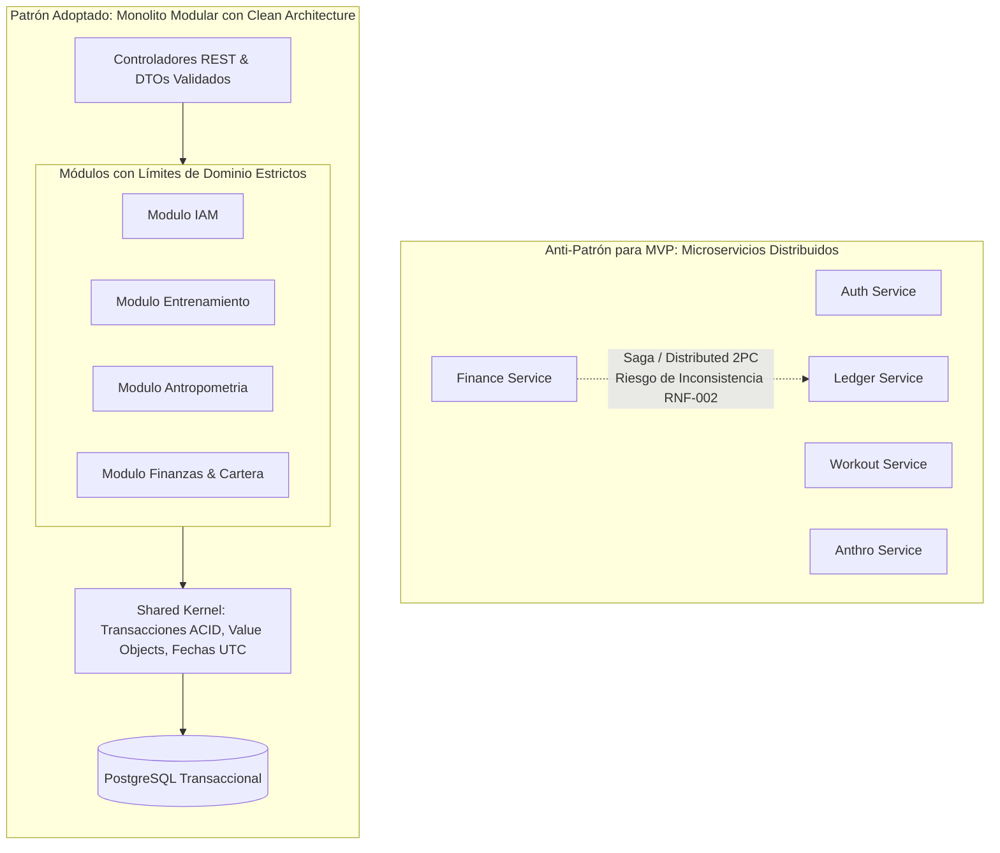

# 🏛️ Evaluación de Alternativas Tecnológicas y Stack Recomendado - MVP GUACHAFIT

> **Objetivo del Documento:** Realizar un análisis comparativo riguroso (*Trade-off Analysis*) y establecer la fundamentación técnica de las elecciones del stack tecnológico para el MVP de **GUACHAFIT**, garantizando el cumplimiento de los requerimientos funcionales (`RF-001` a `RF-009`), no funcionales (`RNF-001`, `RNF-002`) y decisiones arquitecturales previas (`ADR-001`, `ADR-002`, `ADR-003`).

---

## 🧭 1. Resumen Ejecutivo del Stack Tecnológico Recomendado

```mermaid
flowchart TB
    subgraph ClientLayer ["Capa de Clientes (Offline-First & Responsive)"]
        CoachWeb["Entrenador (Desktop / Tablet / Mobile Web)\nReact 19 + Vite + Tailwind CSS\nTanStack Table + Recharts"]
        AthletePWA["Alumno (PWA Instalable / Mobile-First)\nReact 19 + Vite + Workbox + Tailwind\nDexie.js (IndexedDB) + TanStack Query"]
        CameraCanvas["Módulo Cámara & Compresión\nCanvas / OffscreenCanvas API\nWebP 85% (<600 KB, <500ms)"]
        AthletePWA --> CameraCanvas
    end

    subgraph EdgeLayer ["Capa Perimetral & Edge (Cloudflare)"]
        CFDNS["Cloudflare DNS / DDoS / SSL"]
        CFR2["Cloudflare R2 Storage (S3-Compatible)\nBuckets Privados (Fotos & Comprobantes)\nZero Egress Fees + AES-256"]
    end

    subgraph APILayer ["Capa de Aplicación (NestJS Monolito Modular)"]
        Gateway["Reverse Proxy / Nginx / Traefik\nRate Limiting + SSL Termination"]
        
        subgraph CoreBackend ["NestJS Backend (Node.js 22 LTS / TypeScript)"]
            AuthModule["IAM & RBAC Module\nJWT + Passport + Guards"]
            TrainModule["Training Module\n(RF-001, RF-002)"]
            AnthroModule["Anthropometry Module\n(RF-003, RF-004, RNF-001)"]
            FinanceModule["Finance & Ledger Module\n(RF-005, RF-006, RF-007, RF-008, RNF-002)"]
            JobScheduler["BullMQ Scheduler & Workers\nRecordatorios T-5, T-1, T, T+2"]
        end
    end

    subgraph DataLayer ["Capa de Persistencia & Mensajería"]
        Postgres[("PostgreSQL 16+\nExtensiones: uuid-ossp\nTipos: NUMERIC(14,2), TIMESTAMPTZ\nDrizzle ORM + Connection Pooling (PgBouncer)")]
        RedisStore[("Redis 7+ (In-Memory)\nBullMQ Queue Engine\nIdempotency Keys & Session Cache")]
    end

    AthletePWA <-->|HTTPS / REST API / Idempotency-Key| Gateway
    CoachWeb <-->|HTTPS / REST API| Gateway
    AthletePWA -.->|Direct Upload via Presigned PUT URL| CFR2
    Gateway --> CoreBackend
    CoreBackend -->|SQL / Drizzle ORM| Postgres
    CoreBackend -->|Colas & Workers| RedisStore
    CoreBackend -->|Presigned URL Generator (AWS SDK v3)| CFR2
```

---

## 📱 2. Capa de Frontend y Aplicación de Usuario: Alumnos y Entrenador

### 2.1. Contexto Operativo y Requerimientos Críticos
1. **Ambiente de Gimnasio (Offline-First):**
   - Los sótanos, estructuras metálicas y zonas aisladas de los gimnasios provocan pérdidas continuas de cobertura 4G/5G y redes Wi-Fi inestables.
   - El alumno **no puede ver interrumpido su entrenamiento** al tildar una serie (`RF-001`). La UI debe responder en $< 16$ ms (optimistic UI), almacenar el progreso en local y sincronizar con el servidor en segundo plano cuando la red se restablezca.
2. **Cámara y Compresión en Cliente (`RNF-001`):**
   - Las fotos de comida (hasta 4 al día, `RF-002`) y de antropometría (3 fotos por check-in, `RF-003`) no pueden enviarse crudas desde sensores móviles de 48–108 MP (8–15 MB por foto).
   - La compresión debe ocurrir en el dispositivo cliente mediante la API de Canvas/OffscreenCanvas a WebP con calidad 85%, reduciendo el tamaño a $< 600$ KB en $< 500$ ms antes de solicitar la URL presignada.
3. **Dualidad de Roles (Alumno vs. Coach):**
   - **Alumno:** Interacción 95% móvil, sesiones rápidas de 1-Tap, checklist vertical, registro con pantalla sudorosa.
   - **Coach:** Interacción híbrida (móvil en sala para cobros o mediciones rápidas; tablet/desktop para prescripción de rutinas, revisión analítica de curvas de peso y bandeja de conciliación bancaria `RF-007`).

### 2.2. Evaluación de Alternativas

| Criterio | Opción A: PWA Instalable (React 19 + Vite + Dexie/Workbox) | Opción B: React Native con Expo (Expo Router + SQLite) | Opción C: Flutter (Dart + Isar/Hive) |
| :--- | :--- | :--- | :--- |
| **Soporte Offline-first** | ⭐⭐⭐⭐☆ Excelente vía Service Workers (Workbox) + IndexedDB (Dexie.js). TanStack Query Mutation Queue para reintentos. | ⭐⭐⭐⭐⭐ Nativo superior con SQLite local (`expo-sqlite` / WatermelonDB) y persistencia nativa en disco. | ⭐⭐⭐⭐⭐ Excelente mediante base de datos Isar embebida y SQLite. |
| **Acceso a Cámara y Compresión** | ⭐⭐⭐⭐☆ API HTML5 `<input type="file" capture="environment">` o `MediaDevices.getUserMedia()` + Web Worker con `OffscreenCanvas`. Rápido y sin plugins. | ⭐⭐⭐⭐⭐ Acceso nativo directo vía `expo-camera` y `expo-image-manipulator` con subida en background. | ⭐⭐⭐⭐⭐ `camera` package + `flutter_image_compress` en Isolate nativo. |
| **Velocidad de Salida al Mercado (MVP)** | ⭐⭐⭐⭐⭐ **Máxima:** Un único codebase responsivo para Alumnos y Entrenador. Despliegue continuo instantáneo sin revisión de tiendas. | ⭐⭐⭐☆☆ Requiere compilar binarios iOS/Android (EAS Build), tramitar cuentas de desarrollador Apple (\$99/año) y Google (\$25), y esperar revisiones de App Store. | ⭐⭐☆☆☆ Requiere aprender Dart, mantener widgets independientes para web y compilar binarios para dos tiendas móviles. |
| **Experiencia de Usuario (UX) en Gimnasio** | ⭐⭐⭐⭐☆ Instalable en pantalla de inicio (Add to Home Screen / WebAPK). UI idéntica a app nativa con CSS táctil (`touch-action: manipulation`, safe-area-inset). | ⭐⭐⭐⭐⭐ Fluidez nativa a 60/120 fps, transiciones nativas y retroalimentación háptica directa. | ⭐⭐⭐⭐⭐ Renderizado de alto rendimiento vía Skia / Impeller. |
| **Costo Operacional Inicial** | ⭐⭐⭐⭐⭐ **$0 en tiendas de apps.** Actualizaciones directas en el servidor web. | ⭐⭐☆☆☆ Costos de cuentas de Apple/Google, mantenimiento de pipelines de CI/CD para binarios móviles. | ⭐⭐☆☆☆ Costos de cuentas en tiendas y mayor esfuerzo de mantenimiento de dos stacks (Dart + Web). |

### 2.3. Decisión Técnica de Frontend
Se adopta **Opción A: PWA Instalable de Alto Rendimiento**:
- **Stack:** **React 19 + TypeScript + Vite + Tailwind CSS**.
- **Persistencia Offline y Cache:** **Dexie.js (IndexedDB wrapper)** para el almacenamiento local de sesiones de entrenamiento y cola de sincronización mutacional (`SyncQueue`), combinado con **TanStack Query (React Query) v5** configurado con `persistClient`.
- **Service Worker:** **Workbox vía `vite-plugin-pwa`** con estrategia `Stale-While-Revalidate` para assets estáticos y `NetworkFirst` con fallback a IndexedDB para llamadas de consulta de rutinas.
- **Compresión de Imágenes:** Módulo cliente en TypeScript utilizando `OffscreenCanvas` y `image-compression` para generar blobs `image/webp` a resolución máx. de 1920px (lado mayor) y calidad 82-85% antes de invocar el upload directo a storage.
- **Ruta de Crecimiento Futuro:** Dado que la lógica de negocio estará encapsulada en hooks y Zustand/TanStack Query, si en el futuro se requiere empaquetado nativo para Apple App Store / Google Play, la migración a **Capacitor 6** o **React Native** se ejecutará en menos de 2 semanas reutilizando el 80% de los componentes.

---

## ⚙️ 3. Capa de Backend y Arquitectura de Servicios

### 3.1. Contexto Operativo y Requerimientos Críticos
1. **Consistencia Transaccional ACID (`RNF-002`):** El módulo financiero ejecuta operaciones compuestas no negociables: aprobar un pago (`TransaccionPago`), actualizar el monto abonado de la cuota (`CuotaMembresia`), recalcular el saldo pendiente y cambiar su estado (`RF-008`). Todo debe ocurrir bajo una transacción atómica serializada en la misma base de datos.
2. **Domain-Driven Design (DDD):** El sistema cuenta con 6 agregados fuertemente delimitados con reglas de invariantes e identidades claras.
3. **Velocidad de Iteración y Compartición de Tipos:** El equipo debe compartir DTOs, esquemas de validación Zod y tipos TypeScript entre frontend y backend sin desfases.

### 3.2. Evaluación de Arquitectura de Servicios (Monolito Modular vs. Microservicios)



- **Veredicto:** Se adopta un **Monolito Modular** estructurado bajo principios de **Clean / Hexagonal Architecture**. Los microservicios introducen latencia de red, complejidad de despliegue en Kubernetes y el grave riesgo de requerir transacciones distribuidas (Sagas / Two-Phase Commit) para la conciliación de cuotas, lo cual viola directamente la garantía de consistencia estricta exigida por `RNF-002`.

### 3.3. Evaluación de Runtime y Framework

| Criterio | Opción A: Node.js (TypeScript) + NestJS | Opción B: Go (Golang) + Chi / Echo | Opción C: Python + FastAPI |
| :--- | :--- | :--- | :--- |
| **Alineación con DDD y Clean Architecture** | ⭐⭐⭐⭐⭐ **Excelente:** Inyección de dependencias nativa, módulos desacoplados, interceptores, guards y decoradores estándar. | ⭐⭐⭐☆☆ Requiere implementar manualmente la inyección de dependencias y boilerplate extenso para agregados y entidades. | ⭐⭐⭐⭐☆ Buen ecosistema pero menor estructura idiomática para patrones empresariales DDD. |
| **Ecosistema de Tipado End-to-End** | ⭐⭐⭐⭐⭐ Tipos compartidos 100% en TypeScript entre API y PWA (Zod / DTOs unificados). | ⭐⭐☆☆☆ Requiere generadores OpenAPI para sincronizar structs de Go con TypeScript en frontend. | ⭐⭐⭐☆☆ Pydantic genera esquemas OpenAPI, pero requiere paso de compilación para TypeScript en cliente. |
| **Manejo de Transacciones Financieras y ORM** | ⭐⭐⭐⭐⭐ Excelente soporte para transacciones interactivas ACID y bloqueos pesimistas vía Drizzle/Prisma. | ⭐⭐⭐⭐☆ Transacciones SQL directas excelentes, pero los ORMs en Go son menos expresivos para modelos de agregados complejos. | ⭐⭐⭐☆☆ SQLAlchemy 2.0 async tiene mayor complejidad en el manejo de sesiones concurrentes y locks pesimistas. |
| **Ecosistema de Tareas y Colas** | ⭐⭐⭐⭐⭐ **BullMQ:** La librería de colas basada en Redis más madura, observable y confiable de la industria. | ⭐⭐⭐☆☆ Librerías como Asynq existen, pero con menor instrumentación y tooling visual. | ⭐⭐⭐⭐☆ Celery / ARQ son sólidos, pero Celery tiene alta sobrecarga operativa. |
| **Tiempo de Desarrollo y Time-to-Market** | ⭐⭐⭐⭐⭐ Máxima velocidad al unificar el lenguaje en toda la organización (Fullstack TypeScript). | ⭐⭐⭐☆☆ Mayor tiempo de desarrollo y mayor cantidad de líneas de código para el mismo alcance. | ⭐⭐⭐⭐☆ Rápido prototipado, pero mantenimiento a mediano plazo más propenso a inconsistencias de tipos. |

### 3.4. Decisión Técnica de Backend
Se adopta **Opción A: Node.js 22 LTS con TypeScript y NestJS**:
- **Patrón Arquitectónico:** Monolito Modular con arquitectura en capas (Domain $\rightarrow$ Application $\rightarrow$ Infrastructure $\rightarrow$ Presentation).
- **Validación y DTOs:** `Zod` y `class-validator` con pipes globales de transformación estricta (`whitelist: true, forbidNonWhitelisted: true`).
- **Seguridad:** Autenticación JWT con rotación de Refresh Tokens almacenados en cookies `HttpOnly; Secure; SameSite=Strict`, y Guards de RBAC a nivel de endpoint (`ADR-001`).

---

## 🗄️ 4. Capa de Base de Datos y Acceso a Datos

### 4.1. Contexto Operativo y Requerimientos Críticos
- **Cero Tolerancia a Errores de Punto Flotante (`RNF-002`):** Montos financieros almacenados estrictamente como `NUMERIC(14,2)` y tasas de cambio en `NUMERIC(12,4)`.
- **Idempotencia Estricta:** Detección de comprobantes duplicados mediante índices únicos compuestos sobre `(metodo_pago, referencia_bancaria, fecha_operacion)`.
- **Manejo Universal UTC (`ADR-002`):** Todo timestamp debe ser `TIMESTAMPTZ` (almacenado en UTC en PostgreSQL).
- **Concurrencia Financiera:** Bloqueo a nivel de fila (`FOR UPDATE`) durante la aprobación de pagos para evitar condiciones de carrera en el saldo de la cuota.

### 4.2. Evaluación de ORMs para PostgreSQL

| Criterio | Opción A: Drizzle ORM | Opción B: Prisma ORM | Opción C: TypeORM |
| :--- | :--- | :--- | :--- |
| **Transparencia SQL y Control de Transacciones** | ⭐⭐⭐⭐⭐ **Suprema:** Sintaxis SQL-first tipada. Soporte nativo y sin fricción para transacciones interactivas `db.transaction()` y locks pesimistas `for('update')`. | ⭐⭐⭐☆☆ Motor C++ oculto (`query-engine`). Las transacciones interactivas tienen timeouts rígidos y limitaciones en queries crudas concurrentes. | ⭐⭐☆☆☆ Múltiples problemas documentados en gestión de transacciones concurrentes y fugas de conexión. |
| **Sobrecarga en Runtime y Performance** | ⭐⭐⭐⭐⭐ **Cero sobrecarga.** Compila directamente a sentencias SQL parametrizadas sin binarios intermedios. | ⭐⭐☆☆☆ Sobrecarga apreciable de memoria y CPU por el binario Rust/C++ intermediario en runtime. | ⭐⭐⭐☆☆ Rendimiento aceptable pero overhead por decoradores y reflexión de metadatos. |
| **Precisión de Tipos Numéricos** | ⭐⭐⭐⭐⭐ Permite mapear tipos personalizados (`customType` para manejar `Decimal.js` o strings exactos) asegurando cumplimiento de `RNF-002`. | ⭐⭐⭐⭐☆ Soporta `Decimal` vía `decimal.js`, pero la serialización JSON requiere transformaciones manuales constantes. | ⭐⭐⭐☆☆ Históricamente mapea `decimal` a `string` requiriendo casteos manuales propensos a errores. |
| **Evolución y Migraciones** | ⭐⭐⭐⭐⭐ `drizzle-kit` genera scripts SQL puros, versionados, legibles y auditables directamente por el DBA. | ⭐⭐⭐⭐☆ `prisma migrate` es funcional pero depende fuertemente de su DSL propio (`schema.prisma`). | ⭐⭐☆☆☆ Sistema de migraciones propenso a inconsistencias entre entidades y base de datos real. |

### 4.3. Decisión Técnica de Base de Datos y ORM
- **Base de Datos:** **PostgreSQL 16+** con extensiones `uuid-ossp` y `pgcrypto`. Desplegable en Amazon RDS, Neon o Supabase (Managed Postgres).
- **ORM:** **Drizzle ORM** por su máxima eficiencia, control absoluto de sentencias SQL, compatibilidad total con tipos exactos `numeric` y ausencia de motores binarios pesados.
- **Pooling de Conexiones:** Pool transaccional mediante **PgBouncer** o el connection pool nativo de Neon/Supabase para soportar picos de concurrencia sin agotar las conexiones de PostgreSQL.

---

## ☁️ 5. Capa de Almacenamiento de Archivos (Fotos y Comprobantes)

### 5.1. Contexto Operativo y Requerimientos Críticos
- **Privacidad y Biometría (`RNF-001`):** Las fotos de progreso corporal son datos sensibles. El bucket debe ser 100% privado (`Public Access Block: ON`).
- **Direct-to-Storage Uploads:** En picos de check-in (100 fotos/min), las fotos no deben pasar por el servidor Node.js para no colapsar la memoria ni el ancho de banda del backend. El cliente sube directamente al bucket mediante una **Presigned PUT URL**.
- **Visualización Segura:** Las imágenes solo pueden verse a través de **Presigned GET URLs** con un tiempo de expiración (TTL) no mayor a **15 minutos**.
- **Costos de Transferencia (Egress Fees):** Las comparativas de fotos de alta resolución consumen gigabytes de transferencia mensual.

### 5.2. Evaluación de Proveedores de Storage

| Criterio | Opción A: Cloudflare R2 | Opción B: AWS S3 | Opción C: Supabase Storage |
| :--- | :--- | :--- | :--- |
| **Costos de Egress (Descarga de Datos)** | ⭐⭐⭐⭐⭐ **$0.00 / GB.** Cero tarifas de salida a nivel global. Ahorro masivo en visualización frecuente de fotos. | ⭐⭐☆☆☆ \$0.09 / GB tras los primeros 100 GB. Costos impredecibles ante crecimiento de fotos. | ⭐⭐⭐☆☆ Incluido en el tier base pero cobra \$0.09/GB en overages. |
| **Compatibilidad con API S3** | ⭐⭐⭐⭐⭐ 100% compatible con AWS S3 API v4 (`@aws-sdk/client-s3` de Node.js). | ⭐⭐⭐⭐⭐ Estándar de la industria nativo. | ⭐⭐⭐⭐☆ API propietaria + endpoint compatible S3. |
| **Cifrado en Reposo** | ⭐⭐⭐⭐⭐ Cifrado AES-256 automático sin costo adicional. | ⭐⭐⭐⭐⭐ SSE-S3 y SSE-KMS configurables. | ⭐⭐⭐⭐⭐ Cifrado administrado en reposo. |
| **Rendimiento y CDN Integrada** | ⭐⭐⭐⭐⭐ Apalancado en la red Anycast global de Cloudflare en más de 300 ciudades. | ⭐⭐⭐⭐☆ Requiere configurar y pagar CloudFront por separado para tener CDN global. | ⭐⭐⭐⭐☆ Integra Fastly/Cloudflare según el plan. |

### 5.3. Decisión Técnica de Storage
Se adopta **Opción A: Cloudflare R2**:
- Se configura un bucket privado con políticas de acceso cero-público.
- El backend NestJS utiliza el SDK oficial de AWS (`@aws-sdk/s3-request-presigner`) apuntando al endpoint de Cloudflare R2.
- **Flujo de Carga Directa:**
  1. Frontend solicita URL firmada: `POST /api/v1/antropometria/presigned-upload-url`
  2. Backend valida autenticación, permisos RBAC (`ADR-001`) y genera un key único (`alumnos/{alumnoId}/antropometria/{uuid}.webp`) con una URL presignada PUT de 15 min de validez.
  3. Frontend comprime la foto en el dispositivo a WebP y la envía vía `PUT` directo a R2 con cabecera `Content-Type: image/webp`.
  4. Frontend confirma la transacción con el backend enviando la key generada para asociarla al registro de base de datos.
- **Flujo de Lectura:** Cuando el coach o el alumno consultan su evolución, el backend genera URLs presignadas GET dinámicas con TTL de 15 minutos.

---

## ⚡ 6. Motor de Colas, Tareas Programadas y Workers

### 6.1. Contexto Operativo y Requerimientos Críticos
- **Recordatorios de Cobro Automatizados (`RF-008`):** Generación y despacho de notificaciones multicanal (Push/WhatsApp/Email) en hitos exactos relativos a la fecha de corte:
  - $T - 5$ días: Recordatorio preventivo de emisión de cuota.
  - $T - 1$ día: Alerta de vencimiento inminente.
  - $T$ (Día de corte): Notificación de cobro formal.
  - $T + 2$ días: Notificación de mora y recargo operativo.
- **Alertas de Check-in Antropométrico:** Notificaciones en ayunas (06:00 AM hora local del alumno, `ADR-002`).
- **Resiliencia:** Reintentos con retroceso exponencial (*exponential backoff*), deduplicación de trabajos y tolerancia a fallos.

### 6.2. Evaluación de Motores de Colas

| Criterio | Opción A: Redis + BullMQ (Node.js) | Opción B: AWS SQS + Lambda | Opción C: PostgreSQL Listen/Notify / pg_cron |
| :--- | :--- | :--- | :--- |
| **Soporte de Trabajos Diferidos (Delayed Jobs)** | ⭐⭐⭐⭐⭐ **Nativo y Preciso:** Permite agendar jobs con un timestamp exacto en el futuro (`runAt: timestamp_utc`). | ⭐⭐⭐☆☆ SQS solo permite retrasos máximos de 15 minutos (`DelaySeconds: 900`). Requiere EventBridge Scheduler adicional. | ⭐⭐⭐☆☆ Posible mediante tablas de polling o `pg_cron`, pero genera contención en la base de datos relacional. |
| **Facilidad de Desarrollo e Integración NestJS** | ⭐⭐⭐⭐⭐ Módulo oficial `@nestjs/bullmq` listo para producción, decoradores `@Processor()` y tipado completo. | ⭐⭐☆☆☆ Requiere infraestructura cloud de AWS, emuladores locales (LocalStack) y mayor configuración. | ⭐⭐⭐☆☆ Requiere lógica manual de locks en tablas para evitar procesamiento concurrente duplicado. |
| **Deduplicación e Idempotencia** | ⭐⭐⭐⭐⭐ Soporte nativo de `jobId` determinístico. Si se reintenta agendar el recordatorio de la misma cuota, se ignora automáticamente. | ⭐⭐⭐⭐☆ SQS FIFO soporta MessageDeduplicationId en ventanas de 5 minutos. | ⭐⭐⭐☆☆ Requiere índices únicos y sentencias `ON CONFLICT DO NOTHING` en tablas de jobs. |
| **Monitoreo y Observabilidad** | ⭐⭐⭐⭐⭐ Dashboard visual web inmediato con **Bull-Board**. | ⭐⭐⭐☆☆ CloudWatch Metrics / Alarms. | ⭐⭐☆☆☆ Consultas SQL manuales sobre tablas internas de Postgres. |

### 6.3. Decisión Técnica de Colas y Workers
Se adopta **Opción A: Redis 7+ con BullMQ**:
- Despliegue de Redis administrado (ej. Upstash Redis para serverless o Redis Cloud / ElastiCache).
- Dos colas principales en NestJS:
  1. `billing-reminders-queue`: Tareas diferidas con `jobId` generado como `cuota_{cuotaId}_hito_{T-5|T-1|T|T+2}` para evitar envíos dobles de recordatorios.
  2. `notifications-queue`: Despacho en tiempo real de notificaciones push y webhooks de mensajería.
- **Manejo de Estados de Cuota:** Si un alumno paga antes de la fecha de corte (`saldo_pendiente == 0.00`), el evento de dominio `CuotaLiquidadaEvent` cancela inmediatamente los jobs futuros asociados a dicha cuota en BullMQ.

---

## 📊 7. Matriz de Resumen del Stack Tecnológico Completo

| Componente | Tecnología Seleccionada | Versión / Proveedor | Propósito Principal |
| :--- | :--- | :--- | :--- |
| **Lenguaje de Programación** | **TypeScript** | v5.5+ | Tipado estricto extremo compartido entre Frontend y Backend. |
| **Frontend Framework** | **React** | v19.x (con Vite) | Renderizado reactivo, concurrencia y ecosistema universal. |
| **Estilos & UI Kit** | **Tailwind CSS + Radix UI** | Tailwind v3.4+ | Interfaz táctil, accesible y con tiempo de carga mínimo. |
| **Estado y Cache Offline** | **TanStack Query + Dexie.js** | Query v5 / Dexie v4 | Sincronización de datos remotos y persistencia en IndexedDB. |
| **Service Worker / PWA** | **Workbox (vite-plugin-pwa)** | v0.20+ | Caché de assets, manifest PWA y capacidades de instalación móvil. |
| **Backend Framework** | **NestJS** | v10.x / v11.x | Arquitectura modular DDD, inyección de dependencias y robustez. |
| **Base de Datos Relacional** | **PostgreSQL** | v16+ | Consistencia ACID, `NUMERIC(14,2)` y tipos `TIMESTAMPTZ`. |
| **ORM / Data Access** | **Drizzle ORM** | v0.33+ | Tipado SQL-first, migraciones transparentes y control de transacciones. |
| **Almacenamiento de Archivos** | **Cloudflare R2** | S3-Compatible API | Cero costos de descarga, buckets privados y URLs presignadas. |
| **Motor de Colas & Cache** | **Redis + BullMQ** | Redis 7+ / BullMQ v5+ | Tareas diferidas de cobranza e idempotencia de jobs. |
| **Validación de Datos** | **Zod** | v3.23+ | Validación de contratos de API y esquemas de entorno. |
| **Monitoreo & Logs** | **Pino + OpenTelemetry** | - | Logs estructurados JSON de baja latencia y trazabilidad distribuida. |

---

## 🔗 8. Trazabilidad y Referencias
- **Problemas Operativos:** [[PROB-001-adherencia-trazabilidad]], [[PROB-002-cobranza-bimonetaria-fraccionada]].
- **Requerimientos Funcionales:** [[RF-001-checklist-entrenamiento-diario]] al [[RF-009-tablero-control-cartera-morosidad]].
- **Requerimientos No Funcionales:** [[RNF-001-almacenamiento-seguridad-fotos-progreso]], [[RNF-002-consistencia-financiera-idempotencia-pagos]].
- **Decisiones Arquitecturales Vinculadas:**
  - [[ADR-001-modelo-hibrido-auditoria-antropometrica]]
  - [[ADR-002-gestion-fechas-utc-zonas-horarias]]
  - [[ADR-003-deuda-maestra-usd-liquidacion-multitasa]]
  - Nuevos registros técnicos: [[ADR-004-stack-frontend-pwa-offline-first]], [[ADR-005-arquitectura-backend-monolito-modular-nestjs]], [[ADR-006-persistencia-postgresql-drizzle-orm]], [[ADR-007-almacenamiento-fotos-privadas-cloudflare-r2-presigned-urls]], [[ADR-008-motor-colas-background-workers-bullmq]].
