# 🗄️ Esquema Relacional de Base de Datos - GUACHAFIT (PostgreSQL 16+)

> **Objetivo del Documento:** Formalizar el modelo físico y relacional de datos para la plataforma **GUACHAFIT**. El diseño implementa estrictamente las invariantes de dominio DDD de los 6 agregados, la precisión contable sin punto flotante (`RNF-002`), la gestión temporal universal en UTC (`ADR-002`), el modelo bimonetario de deuda maestra (`ADR-003`) y la idempotencia en transacciones financieras.

---

## 📊 1. Diagrama Entidad-Relación (Mermaid ERD)

```mermaid
erDiagram
    %% Core IAM & Perfiles
    USUARIO ||--o{ PERFIL_ALUMNO : "tiene_perfil"
    USUARIO ||--o{ PLAN_MEMBRESIA : "crea_planes"
    USUARIO ||--o{ SESION_ENTRENAMIENTO : "ejecuta_o_asigna"
    USUARIO ||--o{ CHECKIN_NUTRICIONAL : "reporta"
    USUARIO ||--o{ CONTROL_ANTROPOMETRICO : "posee_o_audita"
    USUARIO ||--o{ CUOTA_MEMBRESIA : "titular_o_receptor"
    USUARIO ||--o{ TRANSACCION_PAGO : "paga_o_concilia"

    %% Agregado Entrenamiento
    SESION_ENTRENAMIENTO ||--|{ EJERCICIO_SESION : "contiene"
    EJERCICIO_SESION ||--|{ SERIE_REGISTRO : "registra_series"
    EJERCICIO_CATALOGO ||--o{ EJERCICIO_SESION : "referencia"

    %% Agregado Nutrición
    CHECKIN_NUTRICIONAL ||--o{ FOTO_COMIDA : "adjunta"

    %% Agregado Antropometría
    CONTROL_ANTROPOMETRICO ||--o{ FOTO_ANTROPOMETRIA : "incluye_fotos"

    %% Agregado Membresías & Planes
    PLAN_MEMBRESIA ||--o{ OVERRIDE_CLIENTE_PLAN : "personaliza"
    PLAN_MEMBRESIA ||--o{ CUOTA_MEMBRESIA : "origina"
    PERFIL_ALUMNO ||--o{ OVERRIDE_CLIENTE_PLAN : "aplica_a"

    %% Agregado Facturación & Ledger
    CUOTA_MEMBRESIA ||--o{ TRANSACCION_PAGO : "se_abona_con"

    USUARIO {
        uuid id PK
        string email UK
        string password_hash
        enum_rol rol "entrenador, alumno, admin"
        string nombre
        string apellido
        string telefono
        string timezone "Default UTC"
        boolean activo
        timestamptz created_at_utc
        timestamptz updated_at_utc
    }

    PERFIL_ALUMNO {
        uuid id PK
        uuid usuario_id FK, UK
        uuid entrenador_id FK
        enum_modalidad modalidad "presencial, remoto"
        numeric tasa_fijada_override "NUMERIC(12,4) NULL"
        date fecha_nacimiento
        string genero
        timestamptz created_at_utc
        timestamptz updated_at_utc
    }

    EJERCICIO_CATALOGO {
        uuid id PK
        uuid entrenador_id FK "NULL si global"
        string nombre
        string grupo_muscular
        string patron_movimiento
        text video_url
        boolean activo
    }

    SESION_ENTRENAMIENTO {
        uuid id PK
        uuid alumno_id FK
        uuid rutina_id FK "NULL"
        date fecha_programada
        timestamptz fecha_inicio_utc
        timestamptz fecha_fin_utc
        string timezone_cliente
        enum_estado_sesion estado "planificada, en_progreso, completada, omitida"
        numeric porcentaje_cumplimiento "0.00 a 100.00"
        text notas_alumno
        timestamptz created_at_utc
        timestamptz updated_at_utc
    }

    EJERCICIO_SESION {
        uuid id PK
        uuid sesion_id FK
        uuid ejercicio_id FK
        int orden
        text notas_coach
    }

    SERIE_REGISTRO {
        uuid id PK
        uuid ejercicio_sesion_id FK
        int numero_serie
        int reps_objetivo
        int reps_logradas
        numeric peso_kg "NUMERIC(6,2)"
        numeric rpe "NUMERIC(3,1)"
        boolean completada
        timestamptz timestamp_completada_utc
    }

    CHECKIN_NUTRICIONAL {
        uuid id PK
        uuid alumno_id FK
        date fecha UK "alumno_id + fecha es único"
        enum_semaforo semaforo "cumplido, parcial, no_cumplido"
        int calorias_reportadas
        int proteina_gramos_reportada
        numeric agua_litros "NUMERIC(4,2)"
        string notas_alumno "Max 280 chars"
        timestamptz created_at_utc
        timestamptz updated_at_utc
    }

    FOTO_COMIDA {
        uuid id PK
        uuid checkin_id FK
        enum_tipo_comida tipo_comida "desayuno, almuerzo, cena, snack"
        string storage_key
        timestamptz created_at_utc
    }

    CONTROL_ANTROPOMETRICO {
        uuid id PK
        uuid alumno_id FK
        date fecha_evaluacion
        numeric peso_kg "NUMERIC(5,2) 30 a 300"
        numeric altura_cm "NUMERIC(5,2) 100 a 250"
        numeric porcentaje_grasa "NUMERIC(4,2) 2 a 70"
        numeric cuello_cm "NUMERIC(5,2)"
        numeric pecho_cm "NUMERIC(5,2)"
        numeric cintura_cm "NUMERIC(5,2)"
        numeric cadera_cm "NUMERIC(5,2)"
        numeric brazo_cm "NUMERIC(5,2)"
        numeric muslo_cm "NUMERIC(5,2)"
        enum_modalidad modalidad "presencial, remoto"
        enum_origen origen "presencial_verificado, remoto_autoreporte"
        uuid registrado_por FK
        enum_estado_medicion estado "pendiente_aprobacion, aprobado, rechazado"
        text observaciones_coach
        timestamptz fecha_aprobacion_utc
        timestamptz created_at_utc
        timestamptz updated_at_utc
    }

    FOTO_ANTROPOMETRIA {
        uuid id PK
        uuid control_id FK
        enum_angulo_foto angulo "frontal, lateral, posterior (UK con control_id)"
        string storage_key
        timestamptz created_at_utc
    }

    PLAN_MEMBRESIA {
        uuid id PK
        uuid entrenador_id FK
        string nombre
        text descripcion
        jsonb beneficios "Listado de prestaciones"
        numeric precio_base_usd "NUMERIC(14,2) >= 0"
        int duracion_meses "1, 2, 3, 6, 12"
        boolean activo
        timestamptz created_at_utc
        timestamptz updated_at_utc
    }

    OVERRIDE_CLIENTE_PLAN {
        uuid id PK
        uuid plan_id FK
        uuid cliente_id FK "UK con plan_id"
        numeric precio_acordado_usd "NUMERIC(14,2) NULL"
        numeric tasa_fijada_override "NUMERIC(12,4) NULL"
        jsonb beneficios_personalizados "NULL"
        text motivo_override
        timestamptz created_at_utc
        timestamptz updated_at_utc
    }

    CUOTA_MEMBRESIA {
        uuid id PK
        uuid cliente_id FK
        uuid entrenador_id FK
        uuid plan_id FK
        string periodo "YYYY-MM (UK con cliente_id + plan_id)"
        numeric monto_total_usd "NUMERIC(14,2) > 0"
        numeric monto_abonado_usd "NUMERIC(14,2) >= 0"
        numeric saldo_pendiente_usd "NUMERIC(14,2) >= 0"
        timestamptz fecha_emision_utc
        timestamptz fecha_corte_utc
        enum_estado_cuota estado "emitida, abonada_parcial, al_dia, pendiente_revision, vencida, anulada"
        text notas
        timestamptz created_at_utc
        timestamptz updated_at_utc
    }

    TRANSACCION_PAGO {
        uuid id PK
        uuid cuota_id FK
        uuid cliente_id FK
        uuid entrenador_id FK
        uuid registrado_por FK
        numeric monto_original "NUMERIC(14,2) > 0"
        enum_moneda moneda_original "USD, VES"
        numeric tasa_cambio_fijada "NUMERIC(12,4) > 0"
        numeric monto_equivalente_usd "NUMERIC(14,2) > 0"
        enum_metodo_pago metodo_pago "pago_movil, transferencia, efectivo_usd, etc."
        string referencia_bancaria "UK parcial idempotencia"
        date fecha_operacion
        string comprobante_storage_key "Cloudflare R2"
        enum_estado_conciliacion estado_conciliacion "pendiente, aprobado, rechazado"
        text motivo_rechazo
        timestamptz fecha_reporte_utc
        timestamptz fecha_conciliacion_utc
        timestamptz created_at_utc
        timestamptz updated_at_utc
    }
```



---

## 📜 2. Script DDL Completo en SQL (PostgreSQL 16+)

```sql
-- =============================================================================
-- PROYECTO: GUACHAFIT - SCRIPT DDL DE BASE DE DATOS TRANSACCIONAL
-- MOTOR: PostgreSQL 16+
-- ESTÁNDAR: UTC Universal (ADR-002), Precisión Financiera DECIMAL (RNF-002)
-- AUTOR: Tech Lead & Principal Software Architect
-- =============================================================================

-- 1. EXTENSIONES REQUERIDAS
CREATE EXTENSION IF NOT EXISTS "uuid-ossp";
CREATE EXTENSION IF NOT EXISTS "pgcrypto";

-- 2. TIPOS ENUMERADOS (MÁQUINAS DE ESTADOS Y DOMINIO)
CREATE TYPE enum_rol AS ENUM (
    'entrenador', 
    'alumno', 
    'admin'
);

CREATE TYPE enum_modalidad AS ENUM (
    'presencial', 
    'remoto'
);

CREATE TYPE enum_estado_sesion AS ENUM (
    'planificada', 
    'en_progreso', 
    'completada', 
    'omitida'
);

CREATE TYPE enum_semaforo_nutricional AS ENUM (
    'cumplido', 
    'parcial', 
    'no_cumplido'
);

CREATE TYPE enum_tipo_comida AS ENUM (
    'desayuno', 
    'almuerzo', 
    'cena', 
    'snack'
);

CREATE TYPE enum_origen_antropometria AS ENUM (
    'presencial_verificado', 
    'remoto_autoreporte'
);

CREATE TYPE enum_estado_medicion AS ENUM (
    'pendiente_aprobacion', 
    'aprobado', 
    'rechazado'
);

CREATE TYPE enum_angulo_foto AS ENUM (
    'frontal', 
    'lateral', 
    'posterior'
);

CREATE TYPE enum_estado_cuota AS ENUM (
    'emitida', 
    'abonada_parcial', 
    'al_dia', 
    'pendiente_revision', 
    'vencida', 
    'anulada'
);

CREATE TYPE enum_moneda AS ENUM (
    'USD', 
    'VES'
);

CREATE TYPE enum_metodo_pago AS ENUM (
    'pago_movil', 
    'transferencia_bancaria', 
    'efectivo_usd', 
    'efectivo_ves', 
    'zelle', 
    'binance_usdt', 
    'otro'
);

CREATE TYPE enum_estado_conciliacion AS ENUM (
    'pendiente', 
    'aprobado', 
    'rechazado'
);

-- =============================================================================
-- FUNCIÓN TRIGGER: AUTO-ACTUALIZACIÓN DE updated_at_utc
-- =============================================================================
CREATE OR REPLACE FUNCTION set_updated_at_utc()
RETURNS TRIGGER AS $$
BEGIN
    NEW.updated_at_utc = CURRENT_TIMESTAMP AT TIME ZONE 'UTC';
    RETURN NEW;
END;
$$ LANGUAGE plpgsql;

-- =============================================================================
-- TABLA: usuarios (Identidad, Autenticación y Preferencias)
-- =============================================================================
CREATE TABLE usuarios (
    id UUID PRIMARY KEY DEFAULT uuid_generate_v4(),
    email VARCHAR(255) NOT NULL,
    password_hash VARCHAR(255) NOT NULL,
    rol enum_rol NOT NULL,
    nombre VARCHAR(100) NOT NULL,
    apellido VARCHAR(100) NOT NULL,
    telefono VARCHAR(30),
    timezone VARCHAR(64) NOT NULL DEFAULT 'America/Caracas', -- ADR-002 IANA
    activo BOOLEAN NOT NULL DEFAULT TRUE,
    created_at_utc TIMESTAMP WITH TIME ZONE NOT NULL DEFAULT (CURRENT_TIMESTAMP AT TIME ZONE 'UTC'),
    updated_at_utc TIMESTAMP WITH TIME ZONE NOT NULL DEFAULT (CURRENT_TIMESTAMP AT TIME ZONE 'UTC'),
    CONSTRAINT uq_usuarios_email UNIQUE (email)
);

CREATE TRIGGER trg_usuarios_updated_at
BEFORE UPDATE ON usuarios
FOR EACH ROW EXECUTE FUNCTION set_updated_at_utc();

-- =============================================================================
-- TABLA: perfiles_alumno (Detalles de Modalidad y Tasas de Negocio)
-- =============================================================================
CREATE TABLE perfiles_alumno (
    id UUID PRIMARY KEY DEFAULT uuid_generate_v4(),
    usuario_id UUID NOT NULL,
    entrenador_id UUID NOT NULL,
    modalidad enum_modalidad NOT NULL DEFAULT 'presencial', -- ADR-001
    tasa_fijada_override NUMERIC(12, 4), -- ADR-003 Tasa especial de cambio fija (Bs/USD)
    fecha_nacimiento DATE,
    genero VARCHAR(20),
    created_at_utc TIMESTAMP WITH TIME ZONE NOT NULL DEFAULT (CURRENT_TIMESTAMP AT TIME ZONE 'UTC'),
    updated_at_utc TIMESTAMP WITH TIME ZONE NOT NULL DEFAULT (CURRENT_TIMESTAMP AT TIME ZONE 'UTC'),
    CONSTRAINT uq_perfil_usuario UNIQUE (usuario_id),
    CONSTRAINT fk_perfil_usuario FOREIGN KEY (usuario_id) REFERENCES usuarios(id) ON DELETE CASCADE,
    CONSTRAINT fk_perfil_entrenador FOREIGN KEY (entrenador_id) REFERENCES usuarios(id) ON DELETE RESTRICT,
    CONSTRAINT chk_tasa_override_positiva CHECK (tasa_fijada_override IS NULL OR tasa_fijada_override > 0.0000)
);

CREATE TRIGGER trg_perfiles_alumno_updated_at
BEFORE UPDATE ON perfiles_alumno
FOR EACH ROW EXECUTE FUNCTION set_updated_at_utc();

-- =============================================================================
-- TABLA: ejercicios_catalogo (Biblioteca de Ejercicios)
-- =============================================================================
CREATE TABLE ejercicios_catalogo (
    id UUID PRIMARY KEY DEFAULT uuid_generate_v4(),
    entrenador_id UUID, -- NULL si es del catálogo global del sistema
    nombre VARCHAR(120) NOT NULL,
    grupo_muscular VARCHAR(60) NOT NULL,
    patron_movimiento VARCHAR(60),
    video_url TEXT,
    activo BOOLEAN NOT NULL DEFAULT TRUE,
    created_at_utc TIMESTAMP WITH TIME ZONE NOT NULL DEFAULT (CURRENT_TIMESTAMP AT TIME ZONE 'UTC'),
    CONSTRAINT fk_ejercicio_entrenador FOREIGN KEY (entrenador_id) REFERENCES usuarios(id) ON DELETE CASCADE
);

-- =============================================================================
-- TABLA: sesiones_entrenamiento (Agregado SesionEntrenamiento - RF-001)
-- =============================================================================
CREATE TABLE sesiones_entrenamiento (
    id UUID PRIMARY KEY DEFAULT uuid_generate_v4(),
    alumno_id UUID NOT NULL,
    rutina_id UUID,
    fecha_programada DATE NOT NULL, -- Fecha calendario local del alumno
    fecha_inicio_utc TIMESTAMP WITH TIME ZONE, -- ADR-002
    fecha_fin_utc TIMESTAMP WITH TIME ZONE, -- ADR-002
    timezone_cliente VARCHAR(64) NOT NULL DEFAULT 'America/Caracas',
    estado enum_estado_sesion NOT NULL DEFAULT 'planificada',
    porcentaje_cumplimiento NUMERIC(5, 2) NOT NULL DEFAULT 0.00,
    notas_alumno TEXT,
    created_at_utc TIMESTAMP WITH TIME ZONE NOT NULL DEFAULT (CURRENT_TIMESTAMP AT TIME ZONE 'UTC'),
    updated_at_utc TIMESTAMP WITH TIME ZONE NOT NULL DEFAULT (CURRENT_TIMESTAMP AT TIME ZONE 'UTC'),
    CONSTRAINT fk_sesion_alumno FOREIGN KEY (alumno_id) REFERENCES usuarios(id) ON DELETE CASCADE,
    CONSTRAINT chk_porcentaje_cumplimiento CHECK (porcentaje_cumplimiento >= 0.00 AND porcentaje_cumplimiento <= 100.00)
);

CREATE INDEX idx_sesiones_alumno_fecha ON sesiones_entrenamiento (alumno_id, fecha_programada);
CREATE INDEX idx_sesiones_estado ON sesiones_entrenamiento (estado);

CREATE TRIGGER trg_sesiones_entrenamiento_updated_at
BEFORE UPDATE ON sesiones_entrenamiento
FOR EACH ROW EXECUTE FUNCTION set_updated_at_utc();

-- =============================================================================
-- TABLA: ejercicios_sesion (Ejercicios prescritos para una sesión específica)
-- =============================================================================
CREATE TABLE ejercicios_sesion (
    id UUID PRIMARY KEY DEFAULT uuid_generate_v4(),
    sesion_id UUID NOT NULL,
    ejercicio_id UUID NOT NULL,
    orden INT NOT NULL DEFAULT 1,
    notas_coach TEXT,
    CONSTRAINT fk_ejercicio_sesion_sesion FOREIGN KEY (sesion_id) REFERENCES sesiones_entrenamiento(id) ON DELETE CASCADE,
    CONSTRAINT fk_ejercicio_sesion_ejercicio FOREIGN KEY (ejercicio_id) REFERENCES ejercicios_catalogo(id) ON DELETE RESTRICT
);

CREATE INDEX idx_ejercicios_sesion_sesion ON ejercicios_sesion (sesion_id, orden);

-- =============================================================================
-- TABLA: series_registro (Checklist interactivo de series y pesos - RF-001)
-- =============================================================================
CREATE TABLE series_registro (
    id UUID PRIMARY KEY DEFAULT uuid_generate_v4(),
    ejercicio_sesion_id UUID NOT NULL,
    numero_serie INT NOT NULL,
    reps_objetivo INT NOT NULL,
    reps_logradas INT,
    peso_kg NUMERIC(6, 2), -- Precisión exacta en cargas
    rpe NUMERIC(3, 1), -- Escala RPE 1.0 a 10.0
    completada BOOLEAN NOT NULL DEFAULT FALSE,
    timestamp_completada_utc TIMESTAMP WITH TIME ZONE,
    CONSTRAINT fk_serie_ejercicio_sesion FOREIGN KEY (ejercicio_sesion_id) REFERENCES ejercicios_sesion(id) ON DELETE CASCADE,
    CONSTRAINT chk_serie_positiva CHECK (reps_objetivo > 0 AND (reps_logradas IS NULL OR reps_logradas >= 0)),
    CONSTRAINT chk_peso_positivo CHECK (peso_kg IS NULL OR peso_kg >= 0.00),
    CONSTRAINT chk_rpe_rango CHECK (rpe IS NULL OR (rpe >= 1.0 AND rpe <= 10.0))
);

CREATE INDEX idx_series_ejercicio ON series_registro (ejercicio_sesion_id, numero_serie);

-- =============================================================================
-- TABLA: checkins_nutricionales (Agregado CheckinNutricional - RF-002)
-- =============================================================================
CREATE TABLE checkins_nutricionales (
    id UUID PRIMARY KEY DEFAULT uuid_generate_v4(),
    alumno_id UUID NOT NULL,
    fecha DATE NOT NULL, -- Fecha local
    semaforo enum_semaforo_nutricional NOT NULL,
    calorias_reportadas INT,
    proteina_gramos_reportada INT,
    agua_litros NUMERIC(4, 2),
    notas_alumno VARCHAR(280),
    created_at_utc TIMESTAMP WITH TIME ZONE NOT NULL DEFAULT (CURRENT_TIMESTAMP AT TIME ZONE 'UTC'),
    updated_at_utc TIMESTAMP WITH TIME ZONE NOT NULL DEFAULT (CURRENT_TIMESTAMP AT TIME ZONE 'UTC'),
    CONSTRAINT uq_checkin_nutricional_diario UNIQUE (alumno_id, fecha), -- INV-01 Unicidad
    CONSTRAINT fk_checkin_alumno FOREIGN KEY (alumno_id) REFERENCES usuarios(id) ON DELETE CASCADE,
    CONSTRAINT chk_macros_positivos CHECK (
        (calorias_reportadas IS NULL OR calorias_reportadas >= 0) AND
        (proteina_gramos_reportada IS NULL OR proteina_gramos_reportada >= 0) AND
        (agua_litros IS NULL OR (agua_litros >= 0.00 AND agua_litros <= 15.00))
    )
);

CREATE TRIGGER trg_checkins_nutricionales_updated_at
BEFORE UPDATE ON checkins_nutricionales
FOR EACH ROW EXECUTE FUNCTION set_updated_at_utc();

-- =============================================================================
-- TABLA: fotos_comida (Diario fotográfico con tope de 4 fotos por día - RF-002)
-- =============================================================================
CREATE TABLE fotos_comida (
    id UUID PRIMARY KEY DEFAULT uuid_generate_v4(),
    checkin_id UUID NOT NULL,
    tipo_comida enum_tipo_comida NOT NULL,
    storage_key VARCHAR(255) NOT NULL, -- R2 Key privada
    created_at_utc TIMESTAMP WITH TIME ZONE NOT NULL DEFAULT (CURRENT_TIMESTAMP AT TIME ZONE 'UTC'),
    CONSTRAINT fk_foto_comida_checkin FOREIGN KEY (checkin_id) REFERENCES checkins_nutricionales(id) ON DELETE CASCADE
);

CREATE INDEX idx_fotos_comida_checkin ON fotos_comida (checkin_id);

-- =============================================================================
-- TABLA: controles_antropometricos (Agregado ControlAntropometrico - RF-003, ADR-001)
-- =============================================================================
CREATE TABLE controles_antropometricos (
    id UUID PRIMARY KEY DEFAULT uuid_generate_v4(),
    alumno_id UUID NOT NULL,
    fecha_evaluacion DATE NOT NULL,
    peso_kg NUMERIC(5, 2) NOT NULL, -- 30.00 a 300.00 kg
    altura_cm NUMERIC(5, 2),
    porcentaje_grasa NUMERIC(4, 2), -- 2.00% a 70.00%
    cuello_cm NUMERIC(5, 2),
    pecho_cm NUMERIC(5, 2),
    cintura_cm NUMERIC(5, 2),
    cadera_cm NUMERIC(5, 2),
    brazo_cm NUMERIC(5, 2),
    muslo_cm NUMERIC(5, 2),
    modalidad enum_modalidad NOT NULL,
    origen enum_origen_antropometria NOT NULL,
    registrado_por UUID NOT NULL,
    estado enum_estado_medicion NOT NULL DEFAULT 'pendiente_aprobacion',
    observaciones_coach TEXT,
    fecha_aprobacion_utc TIMESTAMP WITH TIME ZONE,
    created_at_utc TIMESTAMP WITH TIME ZONE NOT NULL DEFAULT (CURRENT_TIMESTAMP AT TIME ZONE 'UTC'),
    updated_at_utc TIMESTAMP WITH TIME ZONE NOT NULL DEFAULT (CURRENT_TIMESTAMP AT TIME ZONE 'UTC'),
    CONSTRAINT fk_control_alumno FOREIGN KEY (alumno_id) REFERENCES usuarios(id) ON DELETE CASCADE,
    CONSTRAINT fk_control_registrado_por FOREIGN KEY (registrado_por) REFERENCES usuarios(id) ON DELETE RESTRICT,
    CONSTRAINT chk_peso_rango CHECK (peso_kg >= 30.00 AND peso_kg <= 300.00),
    CONSTRAINT chk_altura_rango CHECK (altura_cm IS NULL OR (altura_cm >= 100.00 AND altura_cm <= 250.00)),
    CONSTRAINT chk_grasa_rango CHECK (porcentaje_grasa IS NULL OR (porcentaje_grasa >= 2.00 AND porcentaje_grasa <= 70.00)),
    CONSTRAINT chk_perimetros_positivos CHECK (
        (cuello_cm IS NULL OR (cuello_cm >= 10.00 AND cuello_cm <= 150.00)) AND
        (pecho_cm IS NULL OR (pecho_cm >= 20.00 AND pecho_cm <= 250.00)) AND
        (cintura_cm IS NULL OR (cintura_cm >= 20.00 AND cintura_cm <= 250.00)) AND
        (cadera_cm IS NULL OR (cadera_cm >= 20.00 AND cadera_cm <= 250.00)) AND
        (brazo_cm IS NULL OR (brazo_cm >= 10.00 AND brazo_cm <= 100.00)) AND
        (muslo_cm IS NULL OR (muslo_cm >= 15.00 AND muslo_cm <= 150.00))
    )
);

CREATE INDEX idx_controles_alumno_fecha ON controles_antropometricos (alumno_id, fecha_evaluacion DESC);
CREATE INDEX idx_controles_estado ON controles_antropometricos (estado);

CREATE TRIGGER trg_controles_antropometricos_updated_at
BEFORE UPDATE ON controles_antropometricos
FOR EACH ROW EXECUTE FUNCTION set_updated_at_utc();

-- =============================================================================
-- TABLA: fotos_antropometria (Fotos biométricas corporales privadas - RNF-001)
-- =============================================================================
CREATE TABLE fotos_antropometria (
    id UUID PRIMARY KEY DEFAULT uuid_generate_v4(),
    control_id UUID NOT NULL,
    angulo enum_angulo_foto NOT NULL,
    storage_key VARCHAR(255) NOT NULL, -- Key privada en Cloudflare R2
    created_at_utc TIMESTAMP WITH TIME ZONE NOT NULL DEFAULT (CURRENT_TIMESTAMP AT TIME ZONE 'UTC'),
    CONSTRAINT uq_control_angulo UNIQUE (control_id, angulo), -- Máx 1 foto por ángulo
    CONSTRAINT fk_foto_antropometria_control FOREIGN KEY (control_id) REFERENCES controles_antropometricos(id) ON DELETE CASCADE
);

-- =============================================================================
-- TABLA: planes_membresia (Catálogo comercial de planes - RF-005)
-- =============================================================================
CREATE TABLE planes_membresia (
    id UUID PRIMARY KEY DEFAULT uuid_generate_v4(),
    entrenador_id UUID NOT NULL,
    nombre VARCHAR(60) NOT NULL,
    descripcion TEXT,
    beneficios JSONB NOT NULL DEFAULT '[]'::jsonb,
    precio_base_usd NUMERIC(14, 2) NOT NULL, -- RNF-002 Cero coma flotante
    duracion_meses INT NOT NULL DEFAULT 1,
    activo BOOLEAN NOT NULL DEFAULT TRUE,
    created_at_utc TIMESTAMP WITH TIME ZONE NOT NULL DEFAULT (CURRENT_TIMESTAMP AT TIME ZONE 'UTC'),
    updated_at_utc TIMESTAMP WITH TIME ZONE NOT NULL DEFAULT (CURRENT_TIMESTAMP AT TIME ZONE 'UTC'),
    CONSTRAINT fk_plan_entrenador FOREIGN KEY (entrenador_id) REFERENCES usuarios(id) ON DELETE RESTRICT,
    CONSTRAINT chk_plan_precio_positivo CHECK (precio_base_usd >= 0.00),
    CONSTRAINT chk_plan_duracion CHECK (duracion_meses IN (1, 2, 3, 6, 12))
);

CREATE TRIGGER trg_planes_membresia_updated_at
BEFORE UPDATE ON planes_membresia
FOR EACH ROW EXECUTE FUNCTION set_updated_at_utc();

-- =============================================================================
-- TABLA: overrides_cliente_plan (Sobrescrituras comerciales por alumno - RF-005)
-- =============================================================================
CREATE TABLE overrides_cliente_plan (
    id UUID PRIMARY KEY DEFAULT uuid_generate_v4(),
    plan_id UUID NOT NULL,
    cliente_id UUID NOT NULL,
    precio_acordado_usd NUMERIC(14, 2),
    tasa_fijada_override NUMERIC(12, 4),
    beneficios_personalizados JSONB,
    motivo_override TEXT,
    created_at_utc TIMESTAMP WITH TIME ZONE NOT NULL DEFAULT (CURRENT_TIMESTAMP AT TIME ZONE 'UTC'),
    updated_at_utc TIMESTAMP WITH TIME ZONE NOT NULL DEFAULT (CURRENT_TIMESTAMP AT TIME ZONE 'UTC'),
    CONSTRAINT uq_override_plan_cliente UNIQUE (plan_id, cliente_id),
    CONSTRAINT fk_override_plan FOREIGN KEY (plan_id) REFERENCES planes_membresia(id) ON DELETE CASCADE,
    CONSTRAINT fk_override_cliente FOREIGN KEY (cliente_id) REFERENCES usuarios(id) ON DELETE CASCADE,
    CONSTRAINT chk_override_precio_positivo CHECK (precio_acordado_usd IS NULL OR precio_acordado_usd >= 0.00),
    CONSTRAINT chk_override_tasa_positiva CHECK (tasa_fijada_override IS NULL OR tasa_fijada_override > 0.0000)
);

CREATE TRIGGER trg_overrides_cliente_plan_updated_at
BEFORE UPDATE ON overrides_cliente_plan
FOR EACH ROW EXECUTE FUNCTION set_updated_at_utc();

-- =============================================================================
-- TABLA: cuotas_membresia (Agregado CuotaMembresia - RF-008, RNF-002, ADR-003)
-- =============================================================================
CREATE TABLE cuotas_membresia (
    id UUID PRIMARY KEY DEFAULT uuid_generate_v4(),
    cliente_id UUID NOT NULL,
    entrenador_id UUID NOT NULL,
    plan_id UUID NOT NULL,
    periodo VARCHAR(7) NOT NULL, -- Formato YYYY-MM (ej. '2026-10')
    monto_total_usd NUMERIC(14, 2) NOT NULL,
    monto_abonado_usd NUMERIC(14, 2) NOT NULL DEFAULT 0.00,
    saldo_pendiente_usd NUMERIC(14, 2) NOT NULL,
    fecha_emision_utc TIMESTAMP WITH TIME ZONE NOT NULL,
    fecha_corte_utc TIMESTAMP WITH TIME ZONE NOT NULL,
    estado enum_estado_cuota NOT NULL DEFAULT 'emitida',
    notas TEXT,
    created_at_utc TIMESTAMP WITH TIME ZONE NOT NULL DEFAULT (CURRENT_TIMESTAMP AT TIME ZONE 'UTC'),
    updated_at_utc TIMESTAMP WITH TIME ZONE NOT NULL DEFAULT (CURRENT_TIMESTAMP AT TIME ZONE 'UTC'),
    CONSTRAINT uq_cuota_cliente_plan_periodo UNIQUE (cliente_id, plan_id, periodo),
    CONSTRAINT fk_cuota_cliente FOREIGN KEY (cliente_id) REFERENCES usuarios(id) ON DELETE RESTRICT,
    CONSTRAINT fk_cuota_entrenador FOREIGN KEY (entrenador_id) REFERENCES usuarios(id) ON DELETE RESTRICT,
    CONSTRAINT fk_cuota_plan FOREIGN KEY (plan_id) REFERENCES planes_membresia(id) ON DELETE RESTRICT,
    CONSTRAINT chk_cuota_monto_total_positivo CHECK (monto_total_usd > 0.00),
    CONSTRAINT chk_cuota_monto_abonado_valido CHECK (monto_abonado_usd >= 0.00 AND monto_abonado_usd <= monto_total_usd),
    CONSTRAINT chk_cuota_saldo_pendiente_valido CHECK (saldo_pendiente_usd >= 0.00),
    -- Invariante fundamental de balance financiero (RNF-002)
    CONSTRAINT chk_invariante_balance_cuota CHECK (saldo_pendiente_usd = (monto_total_usd - monto_abonado_usd))
);

CREATE INDEX idx_cuotas_cliente_estado ON cuotas_membresia (cliente_id, estado);
CREATE INDEX idx_cuotas_entrenador_corte ON cuotas_membresia (entrenador_id, fecha_corte_utc);
CREATE INDEX idx_cuotas_estado ON cuotas_membresia (estado);

CREATE TRIGGER trg_cuotas_membresia_updated_at
BEFORE UPDATE ON cuotas_membresia
FOR EACH ROW EXECUTE FUNCTION set_updated_at_utc();

-- =============================================================================
-- TABLA: transacciones_pago (Agregado TransaccionPago - RF-006, RF-007, RNF-002)
-- =============================================================================
CREATE TABLE transacciones_pago (
    id UUID PRIMARY KEY DEFAULT uuid_generate_v4(),
    cuota_id UUID NOT NULL,
    cliente_id UUID NOT NULL,
    entrenador_id UUID NOT NULL,
    registrado_por UUID NOT NULL,
    monto_original NUMERIC(14, 2) NOT NULL,
    moneda_original enum_moneda NOT NULL,
    tasa_cambio_fijada NUMERIC(12, 4) NOT NULL, -- ADR-003 Snapshot congelado
    monto_equivalente_usd NUMERIC(14, 2) NOT NULL, -- Crédito neto en USD
    metodo_pago enum_metodo_pago NOT NULL,
    referencia_bancaria VARCHAR(64),
    fecha_operacion DATE NOT NULL,
    comprobante_storage_key VARCHAR(255), -- Key privada en Cloudflare R2
    estado_conciliacion enum_estado_conciliacion NOT NULL DEFAULT 'pendiente',
    motivo_rechazo TEXT,
    fecha_reporte_utc TIMESTAMP WITH TIME ZONE NOT NULL DEFAULT (CURRENT_TIMESTAMP AT TIME ZONE 'UTC'),
    fecha_conciliacion_utc TIMESTAMP WITH TIME ZONE,
    created_at_utc TIMESTAMP WITH TIME ZONE NOT NULL DEFAULT (CURRENT_TIMESTAMP AT TIME ZONE 'UTC'),
    updated_at_utc TIMESTAMP WITH TIME ZONE NOT NULL DEFAULT (CURRENT_TIMESTAMP AT TIME ZONE 'UTC'),
    CONSTRAINT fk_transaccion_cuota FOREIGN KEY (cuota_id) REFERENCES cuotas_membresia(id) ON DELETE RESTRICT,
    CONSTRAINT fk_transaccion_cliente FOREIGN KEY (cliente_id) REFERENCES usuarios(id) ON DELETE RESTRICT,
    CONSTRAINT fk_transaccion_entrenador FOREIGN KEY (entrenador_id) REFERENCES usuarios(id) ON DELETE RESTRICT,
    CONSTRAINT fk_transaccion_registrado_por FOREIGN KEY (registrado_por) REFERENCES usuarios(id) ON DELETE RESTRICT,
    CONSTRAINT chk_transaccion_monto_positivo CHECK (monto_original > 0.00),
    CONSTRAINT chk_transaccion_tasa_positiva CHECK (tasa_cambio_fijada > 0.0000),
    CONSTRAINT chk_transaccion_equivalente_positivo CHECK (monto_equivalente_usd > 0.00)
);

-- ÍNDICE DE IDEMPOTENCIA BANCARIA (RNF-002 Sección 4)
-- Previene duplicación de registros por reintentos accidentales de red
CREATE UNIQUE INDEX uq_transaccion_idempotencia 
ON transacciones_pago (metodo_pago, referencia_bancaria, fecha_operacion) 
WHERE referencia_bancaria IS NOT NULL AND referencia_bancaria <> '';

CREATE INDEX idx_transacciones_cuota ON transacciones_pago (cuota_id);
CREATE INDEX idx_transacciones_bandeja_conciliacion ON transacciones_pago (entrenador_id, estado_conciliacion);

CREATE TRIGGER trg_transacciones_pago_updated_at
BEFORE UPDATE ON transacciones_pago
FOR EACH ROW EXECUTE FUNCTION set_updated_at_utc();

-- =============================================================================
-- TABLA: tasas_cambio_referencia (Historial y Tasa Vigente del Entrenador)
-- =============================================================================
CREATE TABLE tasas_cambio_referencia (
    id UUID PRIMARY KEY DEFAULT uuid_generate_v4(),
    entrenador_id UUID NOT NULL,
    tasa_oficial_bcv NUMERIC(12, 4) NOT NULL,
    tasa_paralelo NUMERIC(12, 4),
    tasa_activa_entrenador NUMERIC(12, 4) NOT NULL,
    fuente VARCHAR(50) NOT NULL DEFAULT 'manual',
    fecha_actualizacion_utc TIMESTAMP WITH TIME ZONE NOT NULL DEFAULT (CURRENT_TIMESTAMP AT TIME ZONE 'UTC'),
    CONSTRAINT fk_tasa_entrenador FOREIGN KEY (entrenador_id) REFERENCES usuarios(id) ON DELETE CASCADE,
    CONSTRAINT chk_tasas_positivas CHECK (
        tasa_oficial_bcv > 0.0000 AND 
        tasa_activa_entrenador > 0.0000 AND
        (tasa_paralelo IS NULL OR tasa_paralelo > 0.0000)
    )
);

CREATE INDEX idx_tasas_entrenador_fecha ON tasas_cambio_referencia (entrenador_id, fecha_actualizacion_utc DESC);
```

---

## 🛡️ 3. Mapeo de Invariantes de Negocio y Restricciones Técnicas

| Requerimiento / ADR | Invariante de Negocio | Implementación en PostgreSQL |
| :--- | :--- | :--- |
| **RNF-002 (Precisión Decimal)** | Cero error binario de redondeo (prohibido IEEE 754 `float`/`double`). | Columnas `NUMERIC(14,2)` para dinero y `NUMERIC(12,4)` para tasas cambiarias. |
| **RNF-002 (Balance de Cuota)** | $\text{saldo\_pendiente\_usd} \equiv \text{monto\_total\_usd} - \text{monto\_abonado\_usd}$. | `CONSTRAINT chk_invariante_balance_cuota CHECK (saldo_pendiente_usd = (monto_total_usd - monto_abonado_usd))` |
| **RNF-002 (Idempotencia)** | No permitir registrar dos veces el mismo pago bancario. | `CREATE UNIQUE INDEX uq_transaccion_idempotencia ON transacciones_pago (metodo_pago, referencia_bancaria, fecha_operacion)` |
| **ADR-002 (Gestión Temporal)** | Todos los instantes almacenados universalmente en meridiano 0 UTC. | Tipo `TIMESTAMP WITH TIME ZONE` con valores normalizados `AT TIME ZONE 'UTC'` y función trigger `set_updated_at_utc()`. |
| **ADR-003 (Deuda Maestra USD)** | Unidad de cuenta en USD y tasa de abonos congelada en el snapshot. | `transacciones_pago.tasa_cambio_fijada` y `transacciones_pago.monto_equivalente_usd` inmutables post-creación. |
| **ADR-001 (RBAC Antropometría)** | Check-ins remotos nacen como `pendiente_aprobacion`. | Valor por defecto `estado enum_estado_medicion DEFAULT 'pendiente_aprobacion'`. |
| **RF-001 (Racha & Límites)** | Porcentaje de cumplimiento entre 0 y 100%, cargas no negativas. | `CHECK (porcentaje_cumplimiento >= 0 AND <= 100)`, `CHECK (peso_kg >= 0)`. |
| **RF-002 (Nutrición Ágil)** | Solo un semáforo nutricional diario por alumno. | `CONSTRAINT uq_checkin_nutricional_diario UNIQUE (alumno_id, fecha)` |

---

## 🔗 4. Trazabilidad y Referencias
- Entidades vinculadas: [[Entidad-SesionEntrenamiento]], [[Entidad-CheckinNutricional]], [[Entidad-ControlAntropometrico]], [[Entidad-PlanMembresia]], [[Entidad-CuotaMembresia]], [[Entidad-TransaccionPago]].
- Requerimientos: [[RF-001-checklist-entrenamiento-diario]] al [[RF-009-tablero-control-cartera-morosidad]], [[RNF-001-almacenamiento-seguridad-fotos-progreso]], [[RNF-002-consistencia-financiera-idempotencia-pagos]].
- Decisiones: [[ADR-001-modelo-hibrido-auditoria-antropometrica]], [[ADR-002-gestion-fechas-utc-zonas-horarias]], [[ADR-003-deuda-maestra-usd-liquidacion-multitasa]], [[ADR-006-persistencia-postgresql-drizzle-orm]].
