# 🗄️ Esquema Relacional de Base de Datos - GUACHAFIT (PostgreSQL 16+)

> **Objetivo del Documento:** Formalizar el modelo físico y relacional de datos para **GUACHAFIT**. El diseño implementa estrictamente las invariantes de dominio DDD de los agregados, la precisión financiera sin coma flotante (`RNF-002`), la gestión temporal universal en UTC (`ADR-002`), el modelo bimonetario de deuda maestra (`ADR-003`), el aislamiento multi-tenant mediante **Row-Level Security (RLS)** (`RNF-003`, `ADR-009`) y la arquitectura de mensajería desacoplada (`RNF-004`, `ADR-010`).

---

## 📊 1. Diagrama Entidad-Relación Integral (Mermaid ERD)

```mermaid
erDiagram
    %% Core IAM & Multi-Tenancy
    USUARIO ||--o| PERFIL_ENTRENADOR : "posee_perfil_tenant"
    USUARIO ||--o| PERFIL_ALUMNO : "posee_ficha_cliente"
    USUARIO ||--o| PREFERENCIA_NOTIFICACION : "configura_alertas"
    USUARIO ||--o{ DISPOSITIVO_USUARIO : "registra_terminales"
    USUARIO ||--o{ NOTIFICACION_IN_APP : "recibe_avisos"

    %% Relación de Tenancy (Entrenador es dueño de sus datos)
    PERFIL_ENTRENADOR ||--o{ PERFIL_ALUMNO : "administra_cartera"
    PERFIL_ENTRENADOR ||--o{ PLAN_MEMBRESIA : "ofrece_planes"
    PERFIL_ENTRENADOR ||--o{ TASA_CAMBIO_REFERENCIA : "configura_tasas"
    PERFIL_ENTRENADOR ||--o{ PLANTILLA_RUTINA : "biblioteca_plantillas"

    %% Agregado Entrenamiento
    PERFIL_ALUMNO ||--o{ SESION_ENTRENAMIENTO : "ejecuta_rutinas"
    SESION_ENTRENAMIENTO ||--|{ EJERCICIO_SESION : "contiene"
    EJERCICIO_SESION ||--|{ SERIE_REGISTRO : "registra_series"
    EJERCICIO_CATALOGO ||--o{ EJERCICIO_SESION : "referencia"

    %% Agregado Nutrición
    PERFIL_ALUMNO ||--o{ CHECKIN_NUTRICIONAL : "reporta_diario"
    CHECKIN_NUTRICIONAL ||--o{ FOTO_COMIDA : "adjunta_platos"
    PERFIL_ALUMNO ||--o| METAS_NUTRICIONALES : "define_metas"

    %% Agregado Antropometría
    PERFIL_ALUMNO ||--o{ CONTROL_ANTROPOMETRICO : "posee_mediciones"
    CONTROL_ANTROPOMETRICO ||--o{ FOTO_ANTROPOMETRIA : "incluye_fotos"

    %% Agregado Membresías & Planes
    PLAN_MEMBRESIA ||--o{ OVERRIDE_CLIENTE_PLAN : "personaliza"
    PLAN_MEMBRESIA ||--o{ CUOTA_MEMBRESIA : "origina_deuda"
    PERFIL_ALUMNO ||--o{ OVERRIDE_CLIENTE_PLAN : "aplica_a"

    %% Agregado Facturación & Ledger
    PERFIL_ALUMNO ||--o{ CUOTA_MEMBRESIA : "titular_obligacion"
    CUOTA_MEMBRESIA ||--o{ TRANSACCION_PAGO : "se_liquida_con"

    USUARIO {
        uuid id PK
        string email UK
        string password_hash
        enum_rol rol "superadmin, entrenador, alumno"
        enum_estado_usuario estado "activo, inactivo, bloqueado"
        string token_invitacion_hash "SHA-256"
        timestamptz token_invitacion_expira
        timestamptz ultimo_acceso_utc
        string timezone "Default UTC"
        string tema_ui "system, dark, light (Dark mode persistente)"
        boolean activo
        timestamptz created_at_utc
        timestamptz updated_at_utc
    }

    PERFIL_ENTRENADOR {
        uuid id PK
        uuid usuario_id FK, UK
        string nombres
        string apellidos
        string nombre_comercial
        string coach_code UK "4 a 15 chars alfanumérico"
        int capacidad_maxima "Default 50 (KPI RF-013)"
        numeric tasa_cambio_global "NUMERIC(12,4)"
        string telefono_contacto
        enum_estado_licencia estado_licencia "activa, suspendida_superadmin"
        timestamptz created_at_utc
        timestamptz updated_at_utc
    }

    PERFIL_ALUMNO {
        uuid id PK
        uuid usuario_id FK, UK
        uuid entrenador_id FK "Tenant Discriminator"
        enum_tipo_documento tipo_documento "V_, E_, PASAPORTE"
        string numero_documento
        string nombres
        string apellidos
        date fecha_nacimiento "Calcula edad al vuelo"
        string telefono_whatsapp
        text ficha_salud_privada "Cifrado AES-256-GCM (RNF-003)"
        enum_estado_alumno estado_activacion "activo, inactivo_pausado, suspendido_pago"
        enum_modalidad modalidad "presencial, remoto"
        numeric tasa_fijada_override "NUMERIC(12,4) NULL"
        int racha_dias "Default 0 (RF-001 RN-02)"
        date racha_ultima_fecha "Última fecha local que incrementó la racha"
        timestamptz deleted_at_utc "Soft delete (RF-012)"
        timestamptz created_at_utc
        timestamptz updated_at_utc
    }

    PREFERENCIA_NOTIFICACION {
        uuid id PK
        uuid usuario_id FK, UK
        boolean notify_payments_push
        boolean notify_payments_email
        boolean notify_workouts_push
        boolean notify_workouts_email
        boolean notify_checkins_push
        boolean notify_checkins_email
        boolean digest_weekly_email
        timestamptz updated_at_utc
    }

    DISPOSITIVO_USUARIO {
        uuid id PK
        uuid usuario_id FK
        string device_token UK "FCM / APNs"
        enum_plataforma_dispositivo platform "ios, android, web"
        boolean is_active
        timestamptz updated_at_utc
    }

    NOTIFICACION_IN_APP {
        uuid id PK
        uuid usuario_id FK
        string titulo
        text cuerpo
        string tipo_evento "PAGO, RUTINA, CHECKIN, SEGURIDAD"
        boolean leida "Default false"
        string link_accion
        timestamptz created_at_utc
    }

    EJERCICIO_CATALOGO {
        uuid id PK
        uuid entrenador_id FK "NULL si global"
        string nombre
        string grupo_muscular
        string patron_movimiento
        text video_url
        boolean activo
    }

    PLANTILLA_RUTINA {
        uuid id PK
        uuid entrenador_id FK "Tenant"
        string nombre "3 a 120 chars"
        enum_nivel_objetivo_plantilla nivel_objetivo "principiante, intermedio, avanzado"
        jsonb bloques "BloqueDiaRutinaDTO[] (1 a 7 días)"
        boolean activa "Soft delete (RF-017)"
        timestamptz created_at_utc
        timestamptz updated_at_utc
    }

    SESION_ENTRENAMIENTO {
        uuid id PK
        uuid alumno_id FK
        uuid rutina_id FK "NULL"
        date fecha_programada
        timestamptz fecha_inicio_utc
        timestamptz fecha_fin_utc
        string timezone_cliente
        enum_estado_sesion estado "planificada, en_progreso, completada, omitida"
        enum_motivo_omision motivo_omision "DESCANSO, INCOMPLETO (Esc. 5)"
        numeric porcentaje_cumplimiento "0.00 a 100.00"
        numeric volumen_total_kg "NUMERIC(8,2)"
        string bloque_id "diaId del bloque origen (RF-001)"
        boolean es_dia_descanso_original "Bloque fuera del día sugerido"
        text notas_alumno
        timestamptz created_at_utc
        timestamptz updated_at_utc
    }

    EJERCICIO_SESION {
        uuid id PK
        uuid sesion_id FK
        uuid ejercicio_id FK
        int orden
        text notas_coach
        int descanso_prescrito_segundos "Default 90"
    }

    SERIE_REGISTRO {
        uuid id PK
        uuid ejercicio_sesion_id FK
        int numero_serie
        int reps_objetivo
        int reps_logradas
        numeric peso_kg "NUMERIC(6,2) real"
        numeric peso_prescrito_kg "NULL si cualitativo"
        numeric rpe "NUMERIC(3,1)"
        int descanso_segundos "Temporizador (objetivo)"
        boolean completada
        timestamptz timestamp_inicio_utc "Marca real de inicio (WU17); NULL sin marca"
        timestamptz timestamp_completada_utc
    }

    CHECKIN_NUTRICIONAL {
        uuid id PK
        uuid alumno_id FK
        date fecha UK "alumno_id + fecha es único"
        enum_semaforo semaforo "cumplido, parcial, no_cumplido"
        int calorias_reportadas
        int proteina_gramos_reportada
        numeric agua_litros "NUMERIC(4,2)"
        string notas_alumno
        timestamptz created_at_utc
        timestamptz updated_at_utc
    }

    FOTO_COMIDA {
        uuid id PK
        uuid checkin_id FK
        enum_tipo_comida tipo_comida "desayuno, almuerzo, cena, snack"
        string storage_key
        timestamptz created_at_utc
    }

    METAS_NUTRICIONALES {
        uuid id PK
        uuid alumno_id FK, UK
        int calorias_objetivo "NULL = no configurado"
        int proteina_gramos_objetivo
        int carbohidratos_gramos_objetivo
        int grasas_gramos_objetivo
        numeric agua_litros_objetivo "NUMERIC(4,2)"
        jsonb recursos "RecursoNutricionalDTO[] (máx 10)"
        timestamptz created_at_utc
        timestamptz updated_at_utc
    }

    CONTROL_ANTROPOMETRICO {
        uuid id PK
        uuid alumno_id FK
        date fecha_evaluacion
        numeric peso_kg "NUMERIC(5,2)"
        numeric altura_cm "NUMERIC(5,2)"
        numeric porcentaje_grasa "NUMERIC(4,2)"
        numeric cuello_cm "NUMERIC(5,2)"
        numeric pecho_cm "NUMERIC(5,2)"
        numeric cintura_cm "NUMERIC(5,2)"
        numeric cadera_cm "NUMERIC(5,2)"
        numeric brazo_cm "NUMERIC(5,2)"
        numeric muslo_cm "NUMERIC(5,2)"
        enum_modalidad modalidad
        enum_origen origen
        uuid registrado_por FK
        enum_estado_medicion estado "pendiente_aprobacion, aprobado, rechazado"
        text observaciones_coach
        timestamptz fecha_aprobacion_utc
        timestamptz created_at_utc
        timestamptz updated_at_utc
    }

    FOTO_ANTROPOMETRIA {
        uuid id PK
        uuid control_id FK
        enum_angulo_foto angulo "frontal, lateral, posterior"
        string storage_key
        timestamptz created_at_utc
    }

    PLAN_MEMBRESIA {
        uuid id PK
        uuid entrenador_id FK "Tenant"
        string nombre
        text descripcion
        jsonb beneficios
        numeric precio_base_usd "NUMERIC(14,2)"
        int duracion_meses "1, 2, 3, 6, 12"
        boolean activo
        timestamptz created_at_utc
        timestamptz updated_at_utc
    }

    OVERRIDE_CLIENTE_PLAN {
        uuid id PK
        uuid plan_id FK
        uuid cliente_id FK "UK con plan_id"
        numeric precio_acordado_usd "NUMERIC(14,2)"
        numeric tasa_fijada_override "NUMERIC(12,4)"
        jsonb beneficios_personalizados
        text motivo_override
        timestamptz created_at_utc
        timestamptz updated_at_utc
    }

    CUOTA_MEMBRESIA {
        uuid id PK
        uuid cliente_id FK
        uuid entrenador_id FK "Tenant"
        uuid plan_id FK
        string periodo "YYYY-MM"
        numeric monto_total_usd "NUMERIC(14,2)"
        numeric monto_abonado_usd "NUMERIC(14,2)"
        numeric saldo_pendiente_usd "NUMERIC(14,2)"
        timestamptz fecha_emision_utc
        timestamptz fecha_corte_utc
        enum_estado_cuota estado "emitida, abonada_parcial, al_dia, pendiente_revision, vencida, anulada"
        text notas
        timestamptz created_at_utc
        timestamptz updated_at_utc
    }

    TRANSACCION_PAGO {
        uuid id PK
        uuid cuota_id FK
        uuid cliente_id FK
        uuid entrenador_id FK "Tenant"
        uuid registrado_por FK
        numeric monto_original "NUMERIC(14,2)"
        enum_moneda moneda_original "USD, VES"
        numeric tasa_cambio_fijada "NUMERIC(12,4)"
        numeric monto_equivalente_usd "NUMERIC(14,2)"
        enum_metodo_pago metodo_pago
        string referencia_bancaria "UK parcial idempotencia"
        date fecha_operacion
        string comprobante_storage_key
        enum_estado_conciliacion estado_conciliacion "pendiente, aprobado, rechazado"
        text motivo_rechazo
        timestamptz fecha_reporte_utc
        timestamptz fecha_conciliacion_utc
        timestamptz created_at_utc
        timestamptz updated_at_utc
    }

    TASA_CAMBIO_REFERENCIA {
        uuid id PK
        uuid entrenador_id FK
        numeric tasa_oficial_bcv "NUMERIC(12,4)"
        numeric tasa_paralelo "NUMERIC(12,4)"
        numeric tasa_activa_entrenador "NUMERIC(12,4)"
        string fuente
        timestamptz fecha_actualizacion_utc
    }
```



---

## 📜 2. Script DDL Completo en SQL (PostgreSQL 16+)

```sql
-- =============================================================================
-- PROYECTO: GUACHAFIT - SCRIPT DDL DE BASE DE DATOS TRANSACCIONAL
-- MOTOR: PostgreSQL 16+
-- ESTÁNDAR: Multi-Tenancy RLS (ADR-009), UTC (ADR-002), Precisión Decimal (RNF-002)
-- AUTOR: Tech Lead & Principal Software Architect
-- =============================================================================

-- 1. EXTENSIONES REQUERIDAS
CREATE EXTENSION IF NOT EXISTS "uuid-ossp";
CREATE EXTENSION IF NOT EXISTS "pgcrypto";

-- 2. TIPOS ENUMERADOS
CREATE TYPE enum_rol AS ENUM (
    'superadmin', 
    'entrenador', 
    'alumno'
);

CREATE TYPE enum_estado_usuario AS ENUM (
    'activo', 
    'inactivo', 
    'bloqueado'
);

CREATE TYPE enum_estado_licencia AS ENUM (
    'activa', 
    'suspendida_superadmin'
);

CREATE TYPE enum_tipo_documento AS ENUM (
    'V_', 
    'E_', 
    'PASAPORTE'
);

CREATE TYPE enum_estado_alumno AS ENUM (
    'activo', 
    'inactivo_pausado', 
    'suspendido_pago'
);

CREATE TYPE enum_modalidad AS ENUM (
    'presencial', 
    'remoto'
);

CREATE TYPE enum_plataforma_dispositivo AS ENUM (
    'ios', 
    'android', 
    'web'
);

CREATE TYPE enum_estado_sesion AS ENUM (
    'planificada', 
    'en_progreso', 
    'completada', 
    'omitida'
);

CREATE TYPE enum_motivo_omision AS ENUM (
    'DESCANSO',
    'INCOMPLETO'
);

CREATE TYPE enum_semaforo_nutricional AS ENUM (
    'cumplido', 
    'parcial', 
    'no_cumplido'
);

CREATE TYPE enum_tipo_comida AS ENUM (
    'desayuno', 
    'almuerzo', 
    'cena', 
    'snack'
);

CREATE TYPE enum_origen_antropometria AS ENUM (
    'presencial_verificado', 
    'remoto_autoreporte'
);

CREATE TYPE enum_estado_medicion AS ENUM (
    'pendiente_aprobacion', 
    'aprobado', 
    'rechazado'
);

CREATE TYPE enum_angulo_foto AS ENUM (
    'frontal', 
    'lateral', 
    'posterior'
);

CREATE TYPE enum_estado_cuota AS ENUM (
    'emitida', 
    'abonada_parcial', 
    'al_dia', 
    'pendiente_revision', 
    'vencida', 
    'anulada'
);

CREATE TYPE enum_moneda AS ENUM (
    'USD', 
    'VES'
);

CREATE TYPE enum_metodo_pago AS ENUM (
    'pago_movil', 
    'transferencia_bancaria', 
    'efectivo_usd', 
    'efectivo_ves', 
    'zelle', 
    'binance_usdt', 
    'otro'
);

CREATE TYPE enum_estado_conciliacion AS ENUM (
    'pendiente', 
    'aprobado', 
    'rechazado'
);

CREATE TYPE enum_nivel_objetivo_plantilla AS ENUM (
    'principiante',
    'intermedio',
    'avanzado'
);

-- =============================================================================
-- FUNCIÓN TRIGGER: AUTO-ACTUALIZACIÓN DE updated_at_utc
-- =============================================================================
CREATE OR REPLACE FUNCTION set_updated_at_utc()
RETURNS TRIGGER AS $$
BEGIN
    NEW.updated_at_utc = CURRENT_TIMESTAMP AT TIME ZONE 'UTC';
    RETURN NEW;
END;
$$ LANGUAGE plpgsql;

-- =============================================================================
-- TABLA: usuarios (Identidad IAM Global)
-- =============================================================================
CREATE TABLE usuarios (
    id UUID PRIMARY KEY DEFAULT uuid_generate_v4(),
    email VARCHAR(255) NOT NULL,
    password_hash VARCHAR(255),
    rol enum_rol NOT NULL,
    estado enum_estado_usuario NOT NULL DEFAULT 'activo',
    token_invitacion_hash VARCHAR(64), -- SHA-256 para bienvenida/activación (RF-011)
    token_invitacion_expira TIMESTAMP WITH TIME ZONE,
    ultimo_acceso_utc TIMESTAMP WITH TIME ZONE,
    timezone VARCHAR(64) NOT NULL DEFAULT 'America/Caracas', -- ADR-002
    tema_ui VARCHAR(10) NOT NULL DEFAULT 'system', -- Soporte Dark mode persistente
    activo BOOLEAN NOT NULL DEFAULT TRUE,
    created_at_utc TIMESTAMP WITH TIME ZONE NOT NULL DEFAULT (CURRENT_TIMESTAMP AT TIME ZONE 'UTC'),
    updated_at_utc TIMESTAMP WITH TIME ZONE NOT NULL DEFAULT (CURRENT_TIMESTAMP AT TIME ZONE 'UTC'),
    CONSTRAINT uq_usuarios_email UNIQUE (email),
    CONSTRAINT chk_usuarios_tema CHECK (tema_ui IN ('system', 'dark', 'light'))
);

CREATE INDEX idx_usuarios_token_hash ON usuarios (token_invitacion_hash) WHERE token_invitacion_hash IS NOT NULL;

CREATE TRIGGER trg_usuarios_updated_at
BEFORE UPDATE ON usuarios
FOR EACH ROW EXECUTE FUNCTION set_updated_at_utc();

-- =============================================================================
-- TABLA: perfiles_entrenador (Tenant Owner - RF-010, ADR-009)
-- =============================================================================
CREATE TABLE perfiles_entrenador (
    id UUID PRIMARY KEY DEFAULT uuid_generate_v4(),
    usuario_id UUID NOT NULL,
    nombres VARCHAR(100) NOT NULL,
    apellidos VARCHAR(100) NOT NULL,
    nombre_comercial VARCHAR(150),
    coach_code VARCHAR(15) NOT NULL, -- Código inmutable para Deep Link (RF-011)
    capacidad_maxima INT NOT NULL DEFAULT 50, -- KPI Macro Capacidad (RF-013)
    tasa_cambio_global NUMERIC(12, 4) NOT NULL DEFAULT 65.0000, -- ADR-003
    telefono_contacto VARCHAR(30) NOT NULL,
    estado_licencia enum_estado_licencia NOT NULL DEFAULT 'activa',
    created_at_utc TIMESTAMP WITH TIME ZONE NOT NULL DEFAULT (CURRENT_TIMESTAMP AT TIME ZONE 'UTC'),
    updated_at_utc TIMESTAMP WITH TIME ZONE NOT NULL DEFAULT (CURRENT_TIMESTAMP AT TIME ZONE 'UTC'),
    CONSTRAINT uq_perfil_entrenador_usuario UNIQUE (usuario_id),
    CONSTRAINT uq_perfil_entrenador_code UNIQUE (coach_code),
    CONSTRAINT fk_perfil_entrenador_usuario FOREIGN KEY (usuario_id) REFERENCES usuarios(id) ON DELETE CASCADE,
    CONSTRAINT chk_capacidad_positiva CHECK (capacidad_maxima >= 1),
    CONSTRAINT chk_tasa_global_positiva CHECK (tasa_cambio_global > 0.0000)
);

CREATE TRIGGER trg_perfiles_entrenador_updated_at
BEFORE UPDATE ON perfiles_entrenador
FOR EACH ROW EXECUTE FUNCTION set_updated_at_utc();

-- =============================================================================
-- TABLA: perfiles_alumno (Ficha Deportiva y Médica del Cliente - RF-011, RF-012)
-- =============================================================================
CREATE TABLE perfiles_alumno (
    id UUID PRIMARY KEY DEFAULT uuid_generate_v4(),
    usuario_id UUID NOT NULL,
    entrenador_id UUID NOT NULL, -- Tenant Discriminator para RLS (ADR-009)
    tipo_documento enum_tipo_documento NOT NULL DEFAULT 'V_',
    numero_documento VARCHAR(30) NOT NULL,
    nombres VARCHAR(100) NOT NULL,
    apellidos VARCHAR(100) NOT NULL,
    fecha_nacimiento DATE NOT NULL,
    telefono_whatsapp VARCHAR(30) NOT NULL,
    ficha_salud_privada TEXT, -- Cifrado AES-256-GCM en aplicación (RNF-003)
    estado_activacion enum_estado_alumno NOT NULL DEFAULT 'activo', -- Máquina de estados (RF-012)
    modalidad enum_modalidad NOT NULL DEFAULT 'presencial', -- ADR-001
    tasa_fijada_override NUMERIC(12, 4), -- ADR-003 Override individual
    racha_dias INT NOT NULL DEFAULT 0, -- RF-001 RN-02: días consecutivos con >= 70% del volumen prescrito
    racha_ultima_fecha DATE, -- Última fecha local (YYYY-MM-DD) que incrementó la racha
    deleted_at_utc TIMESTAMP WITH TIME ZONE, -- Soft Delete (RF-012)
    created_at_utc TIMESTAMP WITH TIME ZONE NOT NULL DEFAULT (CURRENT_TIMESTAMP AT TIME ZONE 'UTC'),
    updated_at_utc TIMESTAMP WITH TIME ZONE NOT NULL DEFAULT (CURRENT_TIMESTAMP AT TIME ZONE 'UTC'),
    CONSTRAINT uq_perfil_alumno_usuario UNIQUE (usuario_id),
    CONSTRAINT uq_alumno_documento_entrenador UNIQUE (tipo_documento, numero_documento, entrenador_id),
    CONSTRAINT fk_perfil_alumno_usuario FOREIGN KEY (usuario_id) REFERENCES usuarios(id) ON DELETE CASCADE,
    CONSTRAINT fk_perfil_alumno_entrenador FOREIGN KEY (entrenador_id) REFERENCES usuarios(id) ON DELETE RESTRICT,
    CONSTRAINT chk_tasa_override_positiva CHECK (tasa_fijada_override IS NULL OR tasa_fijada_override > 0.0000)
);

-- Índice parcial para consultas operativas excluyendo alumnos dados de baja (Soft Delete)
CREATE INDEX idx_alumnos_activos ON perfiles_alumno (entrenador_id, estado_activacion) 
WHERE deleted_at_utc IS NULL;

CREATE TRIGGER trg_perfiles_alumno_updated_at
BEFORE UPDATE ON perfiles_alumno
FOR EACH ROW EXECUTE FUNCTION set_updated_at_utc();

-- =============================================================================
-- TABLA: preferencias_notificacion (Matriz Granular de Consentimiento - RF-015)
-- =============================================================================
CREATE TABLE preferencias_notificacion (
    id UUID PRIMARY KEY DEFAULT uuid_generate_v4(),
    usuario_id UUID NOT NULL,
    notify_payments_push BOOLEAN NOT NULL DEFAULT TRUE,
    notify_payments_email BOOLEAN NOT NULL DEFAULT TRUE,
    notify_workouts_push BOOLEAN NOT NULL DEFAULT TRUE,
    notify_workouts_email BOOLEAN NOT NULL DEFAULT FALSE,
    notify_checkins_push BOOLEAN NOT NULL DEFAULT TRUE,
    notify_checkins_email BOOLEAN NOT NULL DEFAULT FALSE,
    digest_weekly_email BOOLEAN NOT NULL DEFAULT FALSE,
    updated_at_utc TIMESTAMP WITH TIME ZONE NOT NULL DEFAULT (CURRENT_TIMESTAMP AT TIME ZONE 'UTC'),
    CONSTRAINT uq_preferencias_usuario UNIQUE (usuario_id),
    CONSTRAINT fk_preferencias_usuario FOREIGN KEY (usuario_id) REFERENCES usuarios(id) ON DELETE CASCADE
);

CREATE TRIGGER trg_preferencias_updated_at
BEFORE UPDATE ON preferencias_notificacion
FOR EACH ROW EXECUTE FUNCTION set_updated_at_utc();

-- =============================================================================
-- TABLA: dispositivos_usuario (Registro de Tokens Push FCM/APNs - RF-016)
-- =============================================================================
CREATE TABLE dispositivos_usuario (
    id UUID PRIMARY KEY DEFAULT uuid_generate_v4(),
    usuario_id UUID NOT NULL,
    device_token VARCHAR(255) NOT NULL,
    platform enum_plataforma_dispositivo NOT NULL,
    is_active BOOLEAN NOT NULL DEFAULT TRUE,
    updated_at_utc TIMESTAMP WITH TIME ZONE NOT NULL DEFAULT (CURRENT_TIMESTAMP AT TIME ZONE 'UTC'),
    CONSTRAINT uq_dispositivo_token UNIQUE (device_token),
    CONSTRAINT fk_dispositivo_usuario FOREIGN KEY (usuario_id) REFERENCES usuarios(id) ON DELETE CASCADE
);

CREATE INDEX idx_dispositivos_usuario_activos ON dispositivos_usuario (usuario_id) WHERE is_active = TRUE;

CREATE TRIGGER trg_dispositivos_updated_at
BEFORE UPDATE ON dispositivos_usuario
FOR EACH ROW EXECUTE FUNCTION set_updated_at_utc();

-- =============================================================================
-- TABLA: notificaciones_in_app (Bandeja y Centro de Alertas Persistente - RF-014)
-- =============================================================================
CREATE TABLE notificaciones_in_app (
    id UUID PRIMARY KEY DEFAULT uuid_generate_v4(),
    usuario_id UUID NOT NULL,
    titulo VARCHAR(100) NOT NULL,
    cuerpo TEXT NOT NULL,
    tipo_evento VARCHAR(50) NOT NULL, -- PAGO, RUTINA, CHECKIN, SEGURIDAD
    leida BOOLEAN NOT NULL DEFAULT FALSE,
    link_accion VARCHAR(255),
    created_at_utc TIMESTAMP WITH TIME ZONE NOT NULL DEFAULT (CURRENT_TIMESTAMP AT TIME ZONE 'UTC'),
    CONSTRAINT fk_notificacion_in_app_usuario FOREIGN KEY (usuario_id) REFERENCES usuarios(id) ON DELETE CASCADE
);

CREATE INDEX idx_notificaciones_usuario_no_leidas ON notificaciones_in_app (usuario_id, leida, created_at_utc DESC);

-- =============================================================================
-- TABLA: ejercicios_catalogo (Biblioteca de Ejercicios)
-- =============================================================================
CREATE TABLE ejercicios_catalogo (
    id UUID PRIMARY KEY DEFAULT uuid_generate_v4(),
    entrenador_id UUID, -- NULL si es del catálogo global del sistema
    nombre VARCHAR(120) NOT NULL,
    grupo_muscular VARCHAR(60) NOT NULL,
    patron_movimiento VARCHAR(60),
    video_url TEXT,
    activo BOOLEAN NOT NULL DEFAULT TRUE,
    created_at_utc TIMESTAMP WITH TIME ZONE NOT NULL DEFAULT (CURRENT_TIMESTAMP AT TIME ZONE 'UTC'),
    CONSTRAINT fk_ejercicio_entrenador FOREIGN KEY (entrenador_id) REFERENCES usuarios(id) ON DELETE CASCADE
);

-- =============================================================================
-- TABLA: plantillas_rutina (Banco de Plantillas del Coach - RF-017, migración 0003; RLS etapa 1 desde 0005)
-- =============================================================================
CREATE TABLE plantillas_rutina (
    id UUID PRIMARY KEY DEFAULT uuid_generate_v4(),
    entrenador_id UUID NOT NULL, -- Tenant Owner
    nombre VARCHAR(120) NOT NULL,
    nivel_objetivo enum_nivel_objetivo_plantilla NOT NULL,
    bloques JSONB NOT NULL, -- BloqueDiaRutinaDTO[]: copia profunda al asignar (RN-02)
    activa BOOLEAN NOT NULL DEFAULT TRUE, -- Soft delete / visibilidad en biblioteca
    created_at_utc TIMESTAMP WITH TIME ZONE NOT NULL DEFAULT (CURRENT_TIMESTAMP AT TIME ZONE 'UTC'),
    updated_at_utc TIMESTAMP WITH TIME ZONE NOT NULL DEFAULT (CURRENT_TIMESTAMP AT TIME ZONE 'UTC'),
    CONSTRAINT fk_plantilla_entrenador FOREIGN KEY (entrenador_id) REFERENCES usuarios(id) ON DELETE CASCADE
);

CREATE INDEX idx_plantillas_entrenador_activa ON plantillas_rutina (entrenador_id, activa);

CREATE TRIGGER trg_plantillas_rutina_updated_at
BEFORE UPDATE ON plantillas_rutina
FOR EACH ROW EXECUTE FUNCTION set_updated_at_utc();

-- =============================================================================
-- TABLA: sesiones_entrenamiento (Agregado SesionEntrenamiento - RF-001)
-- =============================================================================
CREATE TABLE sesiones_entrenamiento (
    id UUID PRIMARY KEY DEFAULT uuid_generate_v4(),
    alumno_id UUID NOT NULL,
    rutina_id UUID,
    fecha_programada DATE NOT NULL,
    fecha_inicio_utc TIMESTAMP WITH TIME ZONE,
    fecha_fin_utc TIMESTAMP WITH TIME ZONE,
    timezone_cliente VARCHAR(64) NOT NULL DEFAULT 'America/Caracas',
    estado enum_estado_sesion NOT NULL DEFAULT 'planificada',
    motivo_omision enum_motivo_omision, -- RF-001 Esc. 5: DESCANSO | INCOMPLETO
    porcentaje_cumplimiento NUMERIC(5, 2) NOT NULL DEFAULT 0.00,
    volumen_total_kg NUMERIC(8, 2) NOT NULL DEFAULT 0.00, -- Volumen real de la sesión
    bloque_id VARCHAR(64), -- diaId del bloque de rutina origen (RF-001 bloques flexibles)
    es_dia_descanso_original BOOLEAN NOT NULL DEFAULT FALSE, -- true si el bloque no era el sugerido para hoy
    notas_alumno TEXT,
    created_at_utc TIMESTAMP WITH TIME ZONE NOT NULL DEFAULT (CURRENT_TIMESTAMP AT TIME ZONE 'UTC'),
    updated_at_utc TIMESTAMP WITH TIME ZONE NOT NULL DEFAULT (CURRENT_TIMESTAMP AT TIME ZONE 'UTC'),
    CONSTRAINT fk_sesion_alumno FOREIGN KEY (alumno_id) REFERENCES usuarios(id) ON DELETE CASCADE,
    CONSTRAINT chk_porcentaje_cumplimiento CHECK (porcentaje_cumplimiento >= 0.00 AND porcentaje_cumplimiento <= 100.00)
);

CREATE INDEX idx_sesiones_alumno_fecha ON sesiones_entrenamiento (alumno_id, fecha_programada);

CREATE TRIGGER trg_sesiones_entrenamiento_updated_at
BEFORE UPDATE ON sesiones_entrenamiento
FOR EACH ROW EXECUTE FUNCTION set_updated_at_utc();

-- =============================================================================
-- TABLA: ejercicios_sesion & series_registro (Checklist interactivo - RF-001)
-- =============================================================================
CREATE TABLE ejercicios_sesion (
    id UUID PRIMARY KEY DEFAULT uuid_generate_v4(),
    sesion_id UUID NOT NULL,
    ejercicio_id UUID NOT NULL,
    orden INT NOT NULL DEFAULT 1,
    notas_coach TEXT,
    descanso_prescrito_segundos INT NOT NULL DEFAULT 90, -- Descanso prescrito entre series
    CONSTRAINT fk_ejercicio_sesion_sesion FOREIGN KEY (sesion_id) REFERENCES sesiones_entrenamiento(id) ON DELETE CASCADE,
    CONSTRAINT fk_ejercicio_sesion_ejercicio FOREIGN KEY (ejercicio_id) REFERENCES ejercicios_catalogo(id) ON DELETE RESTRICT
);

CREATE TABLE series_registro (
    id UUID PRIMARY KEY DEFAULT uuid_generate_v4(),
    ejercicio_sesion_id UUID NOT NULL,
    numero_serie INT NOT NULL,
    reps_objetivo INT NOT NULL,
    reps_logradas INT,
    peso_kg NUMERIC(6, 2), -- Peso real levantado (se sobrescribe al sincronizar)
    peso_prescrito_kg NUMERIC(6, 2), -- NULL si la prescripción es cualitativa (sin materializar 0.00)
    rpe NUMERIC(3, 1),
    descanso_segundos INT, -- Valor del TEMPORIZADOR de descanso en pantalla (objetivo), no una medición
    completada BOOLEAN NOT NULL DEFAULT FALSE,
    timestamp_inicio_utc TIMESTAMP WITH TIME ZONE, -- WU17: marca real de inicio de la serie (NULL si el alumno no la marcó)
    timestamp_completada_utc TIMESTAMP WITH TIME ZONE,
    -- Descanso real derivado (solo lectura): inicio(serie N) - completada(serie N-1);
    -- entre ejercicios: inicio(primera del siguiente) - completada(última del anterior).
    -- Sin marca de inicio no hay medición (nunca se inventa).
    CONSTRAINT fk_serie_ejercicio_sesion FOREIGN KEY (ejercicio_sesion_id) REFERENCES ejercicios_sesion(id) ON DELETE CASCADE,
    CONSTRAINT chk_serie_positiva CHECK (reps_objetivo > 0 AND (reps_logradas IS NULL OR reps_logradas >= 0)),
    CONSTRAINT chk_peso_positivo CHECK (peso_kg IS NULL OR peso_kg >= 0.00)
);

-- =============================================================================
-- TABLA: checkins_nutricionales & fotos_comida (RF-002)
-- =============================================================================
CREATE TABLE checkins_nutricionales (
    id UUID PRIMARY KEY DEFAULT uuid_generate_v4(),
    alumno_id UUID NOT NULL,
    fecha DATE NOT NULL,
    semaforo enum_semaforo_nutricional NOT NULL,
    calorias_reportadas INT,
    proteina_gramos_reportada INT,
    agua_litros NUMERIC(4, 2),
    notas_alumno VARCHAR(280),
    created_at_utc TIMESTAMP WITH TIME ZONE NOT NULL DEFAULT (CURRENT_TIMESTAMP AT TIME ZONE 'UTC'),
    updated_at_utc TIMESTAMP WITH TIME ZONE NOT NULL DEFAULT (CURRENT_TIMESTAMP AT TIME ZONE 'UTC'),
    CONSTRAINT uq_checkin_nutricional_diario UNIQUE (alumno_id, fecha),
    CONSTRAINT fk_checkin_alumno FOREIGN KEY (alumno_id) REFERENCES usuarios(id) ON DELETE CASCADE
);

CREATE TRIGGER trg_checkins_nutricionales_updated_at
BEFORE UPDATE ON checkins_nutricionales
FOR EACH ROW EXECUTE FUNCTION set_updated_at_utc();

CREATE TABLE fotos_comida (
    id UUID PRIMARY KEY DEFAULT uuid_generate_v4(),
    checkin_id UUID NOT NULL,
    tipo_comida enum_tipo_comida NOT NULL,
    storage_key VARCHAR(255) NOT NULL,
    created_at_utc TIMESTAMP WITH TIME ZONE NOT NULL DEFAULT (CURRENT_TIMESTAMP AT TIME ZONE 'UTC'),
    CONSTRAINT fk_foto_comida_checkin FOREIGN KEY (checkin_id) REFERENCES checkins_nutricionales(id) ON DELETE CASCADE
);

-- =============================================================================
-- TABLA: metas_nutricionales (Metas del coach por alumno - RF-002 RN-01, migración 0009)
-- =============================================================================
-- Una fila por alumno (UNIQUE alumno_id): objetivos opcionales anulables (NULL = "no configurado",
-- nunca 0 fabricado) + recursos educativos por enlace (JSONB, máx 10). El estado "No reportado"
-- del calendario nutricional es DERIVADO: no existe columna; se calcula por ausencia de fila en
-- checkins_nutricionales para el día cerrado (RF-002 §6).
CREATE TABLE metas_nutricionales (
    id UUID PRIMARY KEY DEFAULT uuid_generate_v4(),
    alumno_id UUID NOT NULL,
    calorias_objetivo INT,
    proteina_gramos_objetivo INT,
    carbohidratos_gramos_objetivo INT,
    grasas_gramos_objetivo INT,
    agua_litros_objetivo NUMERIC(4, 2),
    recursos JSONB NOT NULL DEFAULT '[]'::jsonb, -- RecursoNutricionalDTO[]: { titulo, url } (máx 10)
    created_at_utc TIMESTAMP WITH TIME ZONE NOT NULL DEFAULT (CURRENT_TIMESTAMP AT TIME ZONE 'UTC'),
    updated_at_utc TIMESTAMP WITH TIME ZONE NOT NULL DEFAULT (CURRENT_TIMESTAMP AT TIME ZONE 'UTC'),
    CONSTRAINT uq_meta_nutricional_alumno UNIQUE (alumno_id),
    CONSTRAINT fk_meta_nutricional_alumno FOREIGN KEY (alumno_id) REFERENCES usuarios(id) ON DELETE CASCADE
);

-- =============================================================================
-- TABLA: controles_antropometricos & fotos_antropometria (RF-003, RNF-001)
-- =============================================================================
CREATE TABLE controles_antropometricos (
    id UUID PRIMARY KEY DEFAULT uuid_generate_v4(),
    alumno_id UUID NOT NULL,
    fecha_evaluacion DATE NOT NULL,
    peso_kg NUMERIC(5, 2) NOT NULL,
    altura_cm NUMERIC(5, 2),
    porcentaje_grasa NUMERIC(4, 2),
    cuello_cm NUMERIC(5, 2),
    pecho_cm NUMERIC(5, 2),
    cintura_cm NUMERIC(5, 2),
    cadera_cm NUMERIC(5, 2),
    brazo_cm NUMERIC(5, 2),
    muslo_cm NUMERIC(5, 2),
    modalidad enum_modalidad NOT NULL,
    origen enum_origen_antropometria NOT NULL,
    registrado_por UUID NOT NULL,
    estado enum_estado_medicion NOT NULL DEFAULT 'pendiente_aprobacion',
    observaciones_coach TEXT,
    fecha_aprobacion_utc TIMESTAMP WITH TIME ZONE,
    created_at_utc TIMESTAMP WITH TIME ZONE NOT NULL DEFAULT (CURRENT_TIMESTAMP AT TIME ZONE 'UTC'),
    updated_at_utc TIMESTAMP WITH TIME ZONE NOT NULL DEFAULT (CURRENT_TIMESTAMP AT TIME ZONE 'UTC'),
    CONSTRAINT fk_control_alumno FOREIGN KEY (alumno_id) REFERENCES usuarios(id) ON DELETE CASCADE,
    CONSTRAINT fk_control_registrado_por FOREIGN KEY (registrado_por) REFERENCES usuarios(id) ON DELETE RESTRICT,
    CONSTRAINT chk_peso_rango CHECK (peso_kg >= 30.00 AND peso_kg <= 300.00)
);

CREATE TRIGGER trg_controles_antropometricos_updated_at
BEFORE UPDATE ON controles_antropometricos
FOR EACH ROW EXECUTE FUNCTION set_updated_at_utc();

CREATE TABLE fotos_antropometria (
    id UUID PRIMARY KEY DEFAULT uuid_generate_v4(),
    control_id UUID NOT NULL,
    angulo enum_angulo_foto NOT NULL,
    storage_key VARCHAR(255) NOT NULL,
    created_at_utc TIMESTAMP WITH TIME ZONE NOT NULL DEFAULT (CURRENT_TIMESTAMP AT TIME ZONE 'UTC'),
    CONSTRAINT uq_control_angulo UNIQUE (control_id, angulo),
    CONSTRAINT fk_foto_antropometria_control FOREIGN KEY (control_id) REFERENCES controles_antropometricos(id) ON DELETE CASCADE
);

-- =============================================================================
-- TABLA: planes_membresia & overrides (RF-005)
-- =============================================================================
CREATE TABLE planes_membresia (
    id UUID PRIMARY KEY DEFAULT uuid_generate_v4(),
    entrenador_id UUID NOT NULL, -- Tenant Owner
    nombre VARCHAR(60) NOT NULL,
    descripcion TEXT,
    beneficios JSONB NOT NULL DEFAULT '[]'::jsonb,
    precio_base_usd NUMERIC(14, 2) NOT NULL,
    duracion_meses INT NOT NULL DEFAULT 1,
    activo BOOLEAN NOT NULL DEFAULT TRUE,
    created_at_utc TIMESTAMP WITH TIME ZONE NOT NULL DEFAULT (CURRENT_TIMESTAMP AT TIME ZONE 'UTC'),
    updated_at_utc TIMESTAMP WITH TIME ZONE NOT NULL DEFAULT (CURRENT_TIMESTAMP AT TIME ZONE 'UTC'),
    CONSTRAINT fk_plan_entrenador FOREIGN KEY (entrenador_id) REFERENCES usuarios(id) ON DELETE RESTRICT,
    CONSTRAINT chk_plan_precio_positivo CHECK (precio_base_usd >= 0.00)
);

CREATE TRIGGER trg_planes_membresia_updated_at
BEFORE UPDATE ON planes_membresia
FOR EACH ROW EXECUTE FUNCTION set_updated_at_utc();

CREATE TABLE overrides_cliente_plan (
    id UUID PRIMARY KEY DEFAULT uuid_generate_v4(),
    plan_id UUID NOT NULL,
    cliente_id UUID NOT NULL,
    precio_acordado_usd NUMERIC(14, 2),
    tasa_fijada_override NUMERIC(12, 4),
    beneficios_personalizados JSONB,
    motivo_override TEXT,
    created_at_utc TIMESTAMP WITH TIME ZONE NOT NULL DEFAULT (CURRENT_TIMESTAMP AT TIME ZONE 'UTC'),
    updated_at_utc TIMESTAMP WITH TIME ZONE NOT NULL DEFAULT (CURRENT_TIMESTAMP AT TIME ZONE 'UTC'),
    CONSTRAINT uq_override_plan_cliente UNIQUE (plan_id, cliente_id),
    CONSTRAINT fk_override_plan FOREIGN KEY (plan_id) REFERENCES planes_membresia(id) ON DELETE CASCADE,
    CONSTRAINT fk_override_cliente FOREIGN KEY (cliente_id) REFERENCES usuarios(id) ON DELETE CASCADE
);

-- =============================================================================
-- TABLA: cuotas_membresia (Agregado CuotaMembresia - RF-008, RNF-002, ADR-003)
-- =============================================================================
CREATE TABLE cuotas_membresia (
    id UUID PRIMARY KEY DEFAULT uuid_generate_v4(),
    cliente_id UUID NOT NULL,
    entrenador_id UUID NOT NULL, -- Tenant Owner
    plan_id UUID NOT NULL,
    periodo VARCHAR(7) NOT NULL,
    monto_total_usd NUMERIC(14, 2) NOT NULL,
    monto_abonado_usd NUMERIC(14, 2) NOT NULL DEFAULT 0.00,
    saldo_pendiente_usd NUMERIC(14, 2) NOT NULL,
    fecha_emision_utc TIMESTAMP WITH TIME ZONE NOT NULL,
    fecha_corte_utc TIMESTAMP WITH TIME ZONE NOT NULL,
    estado enum_estado_cuota NOT NULL DEFAULT 'emitida',
    notas TEXT,
    created_at_utc TIMESTAMP WITH TIME ZONE NOT NULL DEFAULT (CURRENT_TIMESTAMP AT TIME ZONE 'UTC'),
    updated_at_utc TIMESTAMP WITH TIME ZONE NOT NULL DEFAULT (CURRENT_TIMESTAMP AT TIME ZONE 'UTC'),
    CONSTRAINT uq_cuota_cliente_plan_periodo UNIQUE (cliente_id, plan_id, periodo),
    CONSTRAINT fk_cuota_cliente FOREIGN KEY (cliente_id) REFERENCES usuarios(id) ON DELETE RESTRICT,
    CONSTRAINT fk_cuota_entrenador FOREIGN KEY (entrenador_id) REFERENCES usuarios(id) ON DELETE RESTRICT,
    CONSTRAINT fk_cuota_plan FOREIGN KEY (plan_id) REFERENCES planes_membresia(id) ON DELETE RESTRICT,
    CONSTRAINT chk_cuota_monto_total_positivo CHECK (monto_total_usd > 0.00),
    CONSTRAINT chk_cuota_monto_abonado_valido CHECK (monto_abonado_usd >= 0.00 AND monto_abonado_usd <= monto_total_usd),
    CONSTRAINT chk_cuota_saldo_pendiente_valido CHECK (saldo_pendiente_usd >= 0.00),
    CONSTRAINT chk_invariante_balance_cuota CHECK (saldo_pendiente_usd = (monto_total_usd - monto_abonado_usd))
);

CREATE INDEX idx_cuotas_cliente_estado ON cuotas_membresia (cliente_id, estado);
CREATE INDEX idx_cuotas_entrenador_corte ON cuotas_membresia (entrenador_id, fecha_corte_utc);

CREATE TRIGGER trg_cuotas_membresia_updated_at
BEFORE UPDATE ON cuotas_membresia
FOR EACH ROW EXECUTE FUNCTION set_updated_at_utc();

-- =============================================================================
-- TABLA: transacciones_pago (Agregado TransaccionPago - RF-006, RF-007, RNF-002)
-- =============================================================================
CREATE TABLE transacciones_pago (
    id UUID PRIMARY KEY DEFAULT uuid_generate_v4(),
    cuota_id UUID NOT NULL,
    cliente_id UUID NOT NULL,
    entrenador_id UUID NOT NULL, -- Tenant Owner
    registrado_por UUID NOT NULL,
    monto_original NUMERIC(14, 2) NOT NULL,
    moneda_original enum_moneda NOT NULL,
    tasa_cambio_fijada NUMERIC(12, 4) NOT NULL,
    monto_equivalente_usd NUMERIC(14, 2) NOT NULL,
    metodo_pago enum_metodo_pago NOT NULL,
    referencia_bancaria VARCHAR(64),
    fecha_operacion DATE NOT NULL,
    comprobante_storage_key VARCHAR(255),
    estado_conciliacion enum_estado_conciliacion NOT NULL DEFAULT 'pendiente',
    motivo_rechazo TEXT,
    fecha_reporte_utc TIMESTAMP WITH TIME ZONE NOT NULL DEFAULT (CURRENT_TIMESTAMP AT TIME ZONE 'UTC'),
    fecha_conciliacion_utc TIMESTAMP WITH TIME ZONE,
    created_at_utc TIMESTAMP WITH TIME ZONE NOT NULL DEFAULT (CURRENT_TIMESTAMP AT TIME ZONE 'UTC'),
    updated_at_utc TIMESTAMP WITH TIME ZONE NOT NULL DEFAULT (CURRENT_TIMESTAMP AT TIME ZONE 'UTC'),
    CONSTRAINT fk_transaccion_cuota FOREIGN KEY (cuota_id) REFERENCES cuotas_membresia(id) ON DELETE RESTRICT,
    CONSTRAINT fk_transaccion_cliente FOREIGN KEY (cliente_id) REFERENCES usuarios(id) ON DELETE RESTRICT,
    CONSTRAINT fk_transaccion_entrenador FOREIGN KEY (entrenador_id) REFERENCES usuarios(id) ON DELETE RESTRICT,
    CONSTRAINT fk_transaccion_registrado_por FOREIGN KEY (registrado_por) REFERENCES usuarios(id) ON DELETE RESTRICT,
    CONSTRAINT chk_transaccion_monto_positivo CHECK (monto_original > 0.00),
    CONSTRAINT chk_transaccion_tasa_positiva CHECK (tasa_cambio_fijada > 0.0000),
    CONSTRAINT chk_transaccion_equivalente_positivo CHECK (monto_equivalente_usd > 0.00)
);

CREATE UNIQUE INDEX uq_transaccion_idempotencia 
ON transacciones_pago (metodo_pago, referencia_bancaria, fecha_operacion) 
WHERE referencia_bancaria IS NOT NULL AND referencia_bancaria <> '';

CREATE INDEX idx_transacciones_bandeja_conciliacion ON transacciones_pago (entrenador_id, estado_conciliacion);

CREATE TRIGGER trg_transacciones_pago_updated_at
BEFORE UPDATE ON transacciones_pago
FOR EACH ROW EXECUTE FUNCTION set_updated_at_utc();

-- =============================================================================
-- TABLA: tasas_cambio_referencia (Historial y Tasa Activa - ADR-003)
-- =============================================================================
CREATE TABLE tasas_cambio_referencia (
    id UUID PRIMARY KEY DEFAULT uuid_generate_v4(),
    entrenador_id UUID NOT NULL,
    tasa_oficial_bcv NUMERIC(12, 4) NOT NULL,
    tasa_paralelo NUMERIC(12, 4),
    tasa_activa_entrenador NUMERIC(12, 4) NOT NULL,
    fuente VARCHAR(50) NOT NULL DEFAULT 'manual',
    fecha_actualizacion_utc TIMESTAMP WITH TIME ZONE NOT NULL DEFAULT (CURRENT_TIMESTAMP AT TIME ZONE 'UTC'),
    CONSTRAINT fk_tasa_entrenador FOREIGN KEY (entrenador_id) REFERENCES usuarios(id) ON DELETE CASCADE
);

-- =============================================================================
-- 3. POLÍTICAS DE ROW-LEVEL SECURITY (RLS) MULTI-TENANT (RNF-003, ADR-009)
-- =============================================================================

-- -----------------------------------------------------------------------------
-- ENTREGA POR ETAPAS (migraciones 0004_rls_multitenant.sql, 0005_rls_plantillas.sql y
-- 0012_rls_finanzas.sql):
--   * Políticas creadas para las 6 tablas de RNF-003 + RF-017 (se sumó plantillas_rutina).
--   * ENABLE ROW LEVEL SECURITY aplicado en:
--       - etapa 1: `rutinas` (0004) y `plantillas_rutina` (0005);
--       - etapa 2 (finanzas): `planes_membresia`, `cuotas_membresia` y
--         `transacciones_pago` (0012, migración aditiva que completa las políticas
--         self del alumno para los caminos reales: self-select del plan de su cuota,
--         self-update de la cuota al reportar pago y self-insert de la transacción).
--   * `perfiles_alumno` queda PREPARADA (políticas creadas, ENABLE pendiente:
--     etapa 3) hasta que el 100% de sus caminos corran dentro de withTenant().
-- -----------------------------------------------------------------------------

-- Funciones de sesión (STABLE, sin SECURITY DEFINER: current_setting no requiere privilegios)
CREATE OR REPLACE FUNCTION is_superadmin()
RETURNS boolean LANGUAGE sql STABLE AS $$
  SELECT COALESCE(current_setting('app.is_superadmin', true), 'false') = 'true';
$$;

CREATE OR REPLACE FUNCTION current_entrenador_id()
RETURNS uuid LANGUAGE sql STABLE AS $$
  SELECT NULLIF(current_setting('app.current_entrenador_id', true), '')::uuid;
$$;

CREATE OR REPLACE FUNCTION current_usuario_id()
RETURNS uuid LANGUAGE sql STABLE AS $$
  SELECT NULLIF(current_setting('app.current_usuario_id', true), '')::uuid;
$$;

-- rutinas (ETAPA 1: RLS habilitado)
CREATE POLICY rls_rutinas ON rutinas
  FOR ALL
  USING (is_superadmin() OR entrenador_id = current_entrenador_id())
  WITH CHECK (is_superadmin() OR entrenador_id = current_entrenador_id());

CREATE POLICY rls_rutinas_self_select ON rutinas
  FOR SELECT
  USING (alumno_id = current_usuario_id());

ALTER TABLE rutinas ENABLE ROW LEVEL SECURITY;

-- plantillas_rutina (ETAPA 1: RLS habilitado desde 0005_rls_plantillas.sql)
-- Banco de plantillas del coach (RF-017): sin política "self" (el alumno no accede).
CREATE POLICY rls_plantillas_rutina ON plantillas_rutina
  FOR ALL
  USING (is_superadmin() OR entrenador_id = current_entrenador_id())
  WITH CHECK (is_superadmin() OR entrenador_id = current_entrenador_id());

ALTER TABLE plantillas_rutina ENABLE ROW LEVEL SECURITY;

-- perfiles_alumno — PREPARADA (ENABLE pendiente: etapa 3)
CREATE POLICY rls_perfiles_alumno ON perfiles_alumno
  FOR ALL
  USING (is_superadmin() OR entrenador_id = current_entrenador_id())
  WITH CHECK (is_superadmin() OR entrenador_id = current_entrenador_id());

CREATE POLICY rls_perfiles_alumno_self_select ON perfiles_alumno
  FOR SELECT
  USING (usuario_id = current_usuario_id());

-- planes_membresia — ETAPA 2: RLS habilitado (0012_rls_finanzas.sql)
CREATE POLICY rls_planes_membresia ON planes_membresia
  FOR ALL
  USING (is_superadmin() OR entrenador_id = current_entrenador_id())
  WITH CHECK (is_superadmin() OR entrenador_id = current_entrenador_id());

-- self-select del alumno (0012): solo los planes que respaldan SUS cuotas.
CREATE POLICY rls_planes_membresia_self_select ON planes_membresia
  FOR SELECT
  USING (
    EXISTS (
      SELECT 1 FROM cuotas_membresia c
      WHERE c.plan_id = planes_membresia.id
        AND c.cliente_id = current_usuario_id()
    )
  );

ALTER TABLE planes_membresia ENABLE ROW LEVEL SECURITY;

-- cuotas_membresia — ETAPA 2: RLS habilitado (0012_rls_finanzas.sql)
CREATE POLICY rls_cuotas_membresia ON cuotas_membresia
  FOR ALL
  USING (is_superadmin() OR entrenador_id = current_entrenador_id())
  WITH CHECK (is_superadmin() OR entrenador_id = current_entrenador_id());

CREATE POLICY rls_cuotas_membresia_self_select ON cuotas_membresia
  FOR SELECT
  USING (cliente_id = current_usuario_id());

-- self-update del alumno al reportar su pago (0012): solo su propia fila;
-- la máquina de estados y los montos los valida la aplicación.
CREATE POLICY rls_cuotas_membresia_self_update ON cuotas_membresia
  FOR UPDATE
  USING (cliente_id = current_usuario_id())
  WITH CHECK (cliente_id = current_usuario_id());

ALTER TABLE cuotas_membresia ENABLE ROW LEVEL SECURITY;

-- transacciones_pago — ETAPA 2: RLS habilitado (0012_rls_finanzas.sql)
CREATE POLICY rls_transacciones_pago ON transacciones_pago
  FOR ALL
  USING (is_superadmin() OR entrenador_id = current_entrenador_id())
  WITH CHECK (is_superadmin() OR entrenador_id = current_entrenador_id());

CREATE POLICY rls_transacciones_pago_self_select ON transacciones_pago
  FOR SELECT
  USING (cliente_id = current_usuario_id());

-- self-insert del alumno al reportar su pago (0012).
CREATE POLICY rls_transacciones_pago_self_insert ON transacciones_pago
  FOR INSERT
  WITH CHECK (cliente_id = current_usuario_id());

ALTER TABLE transacciones_pago ENABLE ROW LEVEL SECURITY;

-- ETAPA 3 (PENDIENTE — `perfiles_alumno`): descomentar únicamente cuando TODAS
-- sus consultas de tenant corran dentro de withTenant() y la suite lo verifique.
-- ALTER TABLE perfiles_alumno ENABLE ROW LEVEL SECURITY;

-- REQUISITO DE EFECTIVIDAD: el rol dueño de las tablas ignora RLS y
-- FORCE ROW LEVEL SECURITY solo somete al dueño; los superusers y los roles con
-- BYPASSRLS siguen exentos incluso con FORCE (comprobado empíricamente). La API
-- debe conectarse con un rol NO dueño NOSUPERUSER NOBYPASSRLS (p. ej.
-- `guachafit_app` con GRANT sobre las tablas). SQL de referencia: apéndice de
-- ADR-011.
```

---

## 🛡️ 3. Mapeo de Invariantes de Negocio y Restricciones Técnicas

| Requerimiento / ADR | Invariante de Negocio | Implementación en PostgreSQL |
| :--- | :--- | :--- |
| **RNF-003 / ADR-009 / [[ADR-011-aislamiento-multitenant-rls-progresivo-withtenant]]** | Aislamiento multi-tenant entre carteras de entrenadores (entrega por etapas). | Row-Level Security con funciones `current_entrenador_id()` / `current_usuario_id()` / `is_superadmin()`: `ENABLE` operativo en `rutinas` y `plantillas_rutina` (etapa 1, migraciones `0004`/`0005`) y en las 3 tablas de finanzas `planes_membresia`, `cuotas_membresia` y `transacciones_pago` (etapa 2, migración `0012`); `perfiles_alumno` tiene políticas creadas y `ENABLE` pendiente (etapa 3). Efectividad condicionada a rol de conexión no-dueño `NOSUPERUSER NOBYPASSRLS` (D2: dev aún conecta como dueño; `FORCE RLS` no cubre a superusers/`BYPASSRLS`). |
| **RF-011 / RNF-003** | Ficha de salud privada confidencial (exclusiva del coach). | Columna `ficha_salud_privada TEXT` cifrada con `AES-256-GCM` y excluida de los DTOs de alumnos. |
| **RF-012 (Soft Delete)** | Preservación del histórico deportivo y contable al dar de baja un cliente. | Columna `deleted_at_utc` con índice parcial `WHERE deleted_at_utc IS NULL`. |
| **RNF-002 (Precisión Decimal)** | Cero error binario de redondeo (prohibido IEEE 754 `float`/`double`). | Columnas `NUMERIC(14,2)` para dinero y `NUMERIC(12,4)` para tasas cambiarias. |
| **RNF-002 (Balance de Cuota)** | $\text{saldo\_pendiente\_usd} \equiv \text{monto\_total\_usd} - \text{monto\_abonado\_usd}$. | `CONSTRAINT chk_invariante_balance_cuota CHECK (saldo_pendiente_usd = (monto_total_usd - monto_abonado_usd))` |
| **RNF-002 (Idempotencia)** | No permitir registrar dos veces el mismo pago bancario. | `CREATE UNIQUE INDEX uq_transaccion_idempotencia ON transacciones_pago (metodo_pago, referencia_bancaria, fecha_operacion)` |
| **ADR-002 (Gestión Temporal)** | Todos los instantes almacenados universalmente en meridiano 0 UTC. | Tipo `TIMESTAMP WITH TIME ZONE` con valores normalizados `AT TIME ZONE 'UTC'` y triggers `set_updated_at_utc()`. |
| **ADR-003 (Deuda Maestra USD)** | Unidad de cuenta en USD y tasa de abonos congelada en el snapshot. | `transacciones_pago.tasa_cambio_fijada` y `transacciones_pago.monto_equivalente_usd` inmutables post-creación. |
| **RF-015 / RF-016** | Unicidad de tokens de dispositivos y matriz 1 a 1 de preferencias. | `UNIQUE (device_token)` en `dispositivos_usuario` y `UNIQUE (usuario_id)` en `preferencias_notificacion`. |
| **RF-002 (Metas Nutricionales)** | Una fila de metas por alumno: cada objetivo es anulable (`NULL` = no configurado, nunca `0` fabricado) y admite hasta 10 recursos educativos por enlace. | Tabla `metas_nutricionales` con `UNIQUE (alumno_id)` y FK `alumno_id → usuarios(id) ON DELETE CASCADE` (migración `0009`). |
| **RF-002 (Calendario Nutricional)** | El estado `No reportado` del calendario es derivado, no un dato persistido. | Sin columna de estado: se calcula por la ausencia de fila en `checkins_nutricionales` para el día cerrado (RF-002 §6). |

### 3.1. Estado de Implementación RLS (2026-09-23)

| Tabla | Políticas creadas | `ENABLE RLS` | Caminos de tenant envueltos en `withTenant` |
| :--- | :---: | :---: | :--- |
| `rutinas` | ✅ | ✅ (etapa 1, WU7) | 100% |
| `plantillas_rutina` | ✅ | ✅ (etapa 1, WU11 — migración `0005`) | 100% |
| `planes_membresia` | ✅ (+ self-select, 0012) | ✅ (etapa 2 — migración `0012`) | 100% |
| `cuotas_membresia` | ✅ (+ self-update, 0012) | ✅ (etapa 2 — migración `0012`) | 100% |
| `transacciones_pago` | ✅ (+ self-insert, 0012) | ✅ (etapa 2 — migración `0012`) | 100% |
| `perfiles_alumno` | ✅ | ⏳ pendiente (etapa 3, prevista en `0013`) | parcial |

> **Verificación real de etapas 1 y 2 ejecutada:** la suite `rnf003-rls-multitenant.spec.ts` valida mecanismo/contrato con mocks y la batería real contra PostgreSQL con rol no-dueño `NOSUPERUSER NOBYPASSRLS` confirmó `deny-by-default` sin GUC, aislamiento por GUC, bypass superadmin explícito y bloqueo de escrituras cross-tenant en `rutinas` y `plantillas_rutina` (etapa 1, rol `guachafit_rls_test`) y en las 3 tablas de finanzas (etapa 2, E2E 30/30 con rol `guachafit_app` + batería psql independiente). **D2:** el `.env` de dev sigue conectando como rol dueño (`postgres`), por lo que el enforcement real exige apuntar `DATABASE_URL` a `guachafit_app`; **nota:** las políticas self acotan fila, no columnas/montos (la app valida transiciones y montos). `FORCE ROW LEVEL SECURITY` no sustituye al rol no-dueño (superusers/`BYPASSRLS` la ignoran); la etapa 3 (`perfiles_alumno`) debe repetir la batería. Ver [[ADR-011-aislamiento-multitenant-rls-progresivo-withtenant]].

---

## 🔗 4. Trazabilidad y Referencias
- Entidades vinculadas: [[Entidad-Usuario]], [[Entidad-PerfilEntrenador]], [[Entidad-PerfilAlumno]], [[Entidad-PreferenciaNotificacion]], [[Entidad-DispositivoUsuario]], [[Entidad-NotificacionInApp]], [[Entidad-SesionEntrenamiento]], [[Entidad-PlantillaRutina]], [[Entidad-CheckinNutricional]], [[Entidad-ControlAntropometrico]], [[Entidad-PlanMembresia]], [[Entidad-CuotaMembresia]], [[Entidad-TransaccionPago]].
- Requerimientos asociados: [[RF-001-checklist-entrenamiento-diario]] al [[RF-017-banco-plantillas-rutinas-entrenamiento]], [[RNF-001-almacenamiento-seguridad-fotos-progreso]] al [[RNF-004-resiliencia-notificaciones-idempotencia-fallbacks]].
- Decisiones arquitecturales: [[ADR-001-modelo-hibrido-auditoria-antropometrica]] al [[ADR-010-arquitectura-event-driven-notificaciones-multicanal]]; aislamiento por etapas en [[ADR-011-aislamiento-multitenant-rls-progresivo-withtenant]].

---

## 🐳 5. Entorno Local Docker, Migraciones y Seeding Enriquecido

Para levantar y operar la persistencia local en desarrollo:

1. **Levantar Contenedores:**
   ```bash
   docker compose up -d
   ```
   *Servicios:* `guachafit-postgres` (PostgreSQL 16 en `:5432`), `guachafit-redis` (Redis 7 en `:6379`), `guachafit-minio` (API S3 en `:9000`, Consola Web en `:9001`) y `guachafit-minio-init` (crea el bucket `guachafit-r2-local`).

2. **Aplicar Migraciones DDL (Drizzle ORM):**
   ```bash
   pnpm db:generate   # Genera el SQL en packages/database/drizzle/
   pnpm db:migrate    # Aplica las migraciones al contenedor PostgreSQL
   ```

3. **Poblar Dataset Realista de Prueba:**
   ```bash
   pnpm db:seed       # Ejecuta packages/database/src/seed.ts
   ```
   *Datos generados:*
   - **1 Entrenador Demo:** `entrenador@guachafit.com` (password: `Password123!`, hash bcrypt).
   - **5 Alumnos Demo:** Al día ($35 USD), con pago reportado en VES (Bs. 1.295 a tasa BCV 37.00), moroso con cuota vencida ($40 USD), invitado con código de vinculación (`GUACHA-8821`), e inactivo pausado.
   - **Catálogo:** 20 ejercicios clasificados por grupo muscular y plantilla Push/Pull/Legs.
   - **Finanzas:** Historial de 7 días de tasas BCV fluctuando entre 36.50 y 37.20 VES/USD.
   - **Salud & Antropometría:** Registro con fotos mock en MinIO y ficha médica confidencial cifrada con `AES-256-GCM` (`RNF-003`).

4. **Explorador Visual:**
   ```bash
   pnpm db:studio     # Drizzle Studio en http://localhost:4983
   ```

